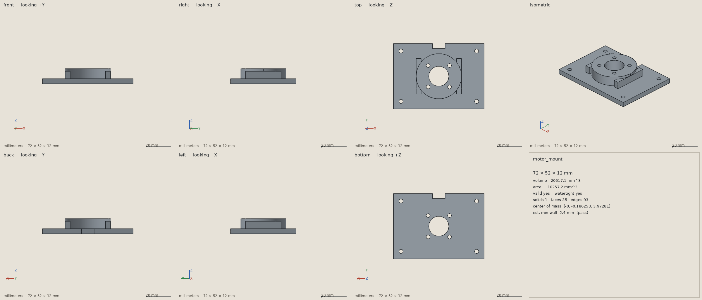
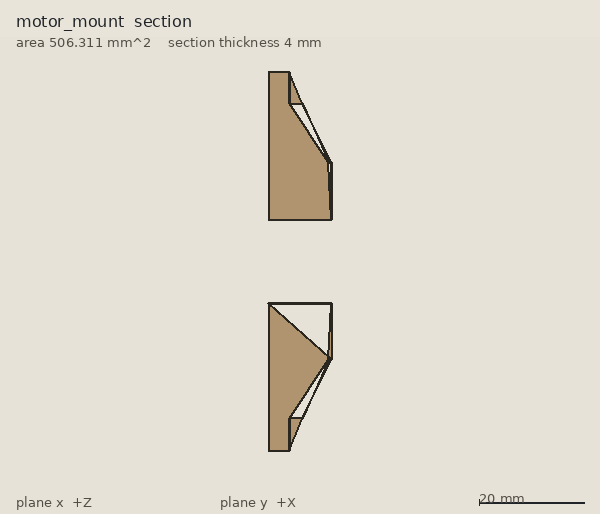
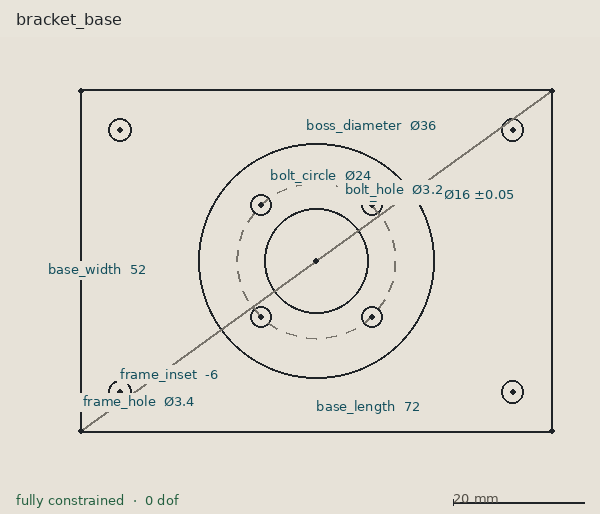
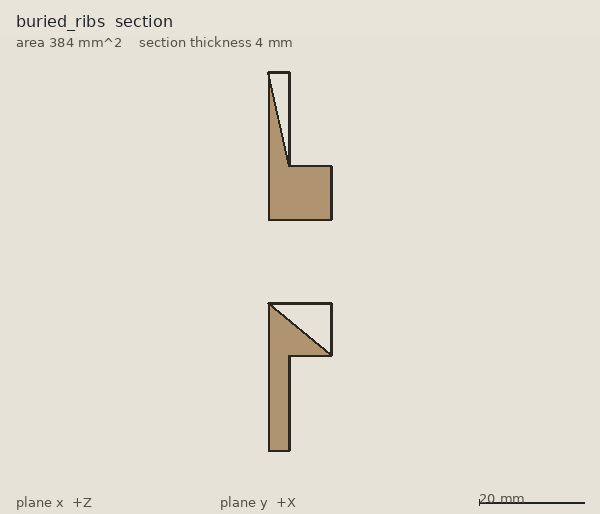
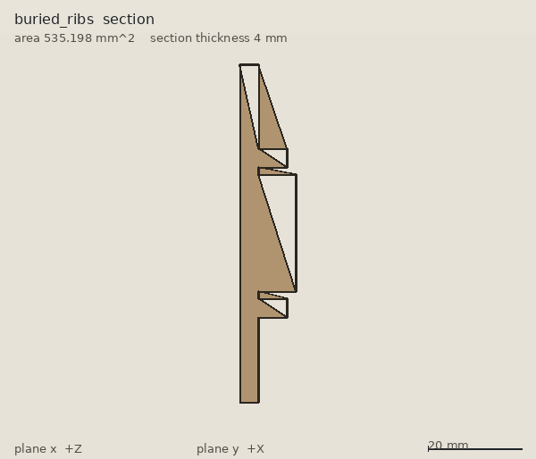
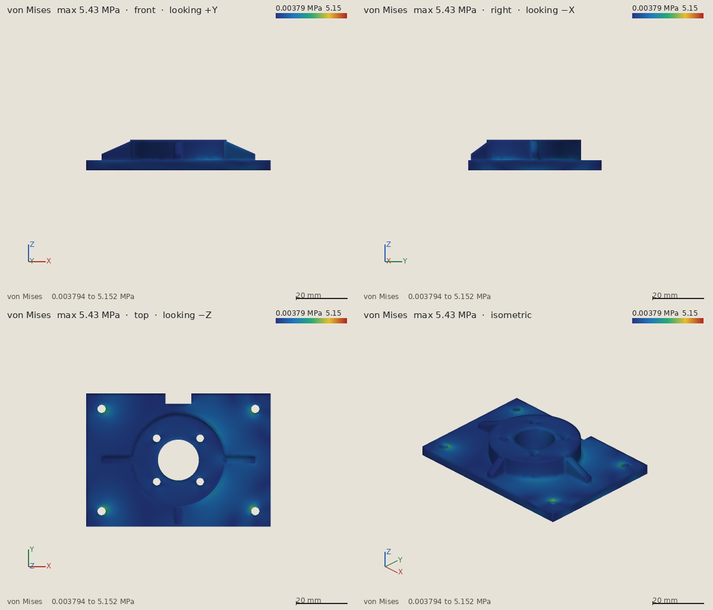
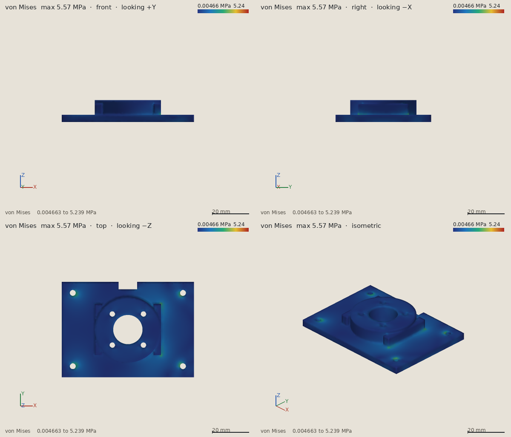

# aicad

A CAD tool built so an assistant can use it as well as a person can.

Today an assistant writing CAD code (OpenSCAD, CadQuery, build123d) works blind. It emits a script and hopes the solid is the one you described. aicad is the missing perception loop: after each modeling step the assistant can look at the part and check it. The focus is hard-body mechanical parts, the kind you print or bolt onto a robot.

This is a small first version. It does not invent a geometry kernel. [build123d](https://github.com/gumyr/build123d) (OpenCascade) sits behind one module, `aicad.kernel`, so it can be swapped later. Everything an assistant calls is plain Python, a CLI, or an MCP server.







## What you can do

- Describe a 2D profile the way a sketcher does: points, lines, arcs, and circles, plus geometric and dimensional constraints. SolveSpace solves it and reports whether it is fully constrained, still free, or conflicting. Extrude, revolve, or cut the solved profile into a solid. Change a named dimension and the solid rebuilds.
- Create or replace a part by running a build123d script, or with a short list of `add` / `cut` boxes and cylinders.
- Optionally record each boolean step with `feature.add` / `feature.cut`, and see how much of an added solid was already buried inside the part.
- Keep a document of named parts and sketches on disk. The script, the operation list, the sketch plus its build steps, a catalog part, or a copied STEP file is the source. Opening the workspace rebuilds the solids.
- Measure a part: bounding box, volume, surface area, center of mass, face and edge counts, and whether the solid is valid and watertight.
- Render it headless, with no GPU and no display: front, back, left, right, top, bottom, isometric, one contact sheet, and a planar section. The MCP tools return those pictures so the assistant can see them.
- Export STEP and STL. Import a STEP file and place it.
- Search a small catalog of real screws, nuts, washers, and ball bearings, insert one, and check clearance against your part.
- Estimate minimum wall thickness from rays and from cross-sections, and compare it with a threshold. The report says which method produced the number.
- Check interference or clearance between two parts.
- Run a linear static check. Pick a material (PLA, PETG, ABS, nylon, aluminum 6061, or mild steel), hold faces and apply forces, pressures, or bolt loads by describing the face, and read the peak von Mises stress, the peak displacement, the minimum safety factor, and a pass/fail against a target. Stress and displacement pictures come back from several angles.

Units are millimeters. Forces are newtons, so a stress from the solver is in megapascals.

## Install

You need Python 3.11 or newer. The OpenCascade wheel that build123d depends on is large.

```bash
python -m venv .venv
source .venv/bin/activate
pip install -e ".[dev]"
pytest
```

The sketch solver is [python-solvespace](https://github.com/KmolYuan/solvespace), a wrapper around the SolveSpace geometric constraint solver. That solver is GPL-3.0-or-later. aicad itself is AGPL-3.0-or-later; installing aicad also installs the GPL solver. If pip has no wheel for your Python, it compiles the solver and needs a C++ compiler plus Python headers (`python3-dev` and `g++` on Debian or Ubuntu).

The mechanics solver is [CalculiX](https://www.calculix.de/) (`ccx`), which is GPL. Meshing uses [Gmsh](https://gmsh.info/), also GPL, through the `gmsh` Python module that pip installs with aicad. Install the CalculiX binary separately:

```bash
sudo apt-get install -y calculix-ccx
```

`aicad fea` reports a clear error when `ccx` is missing. The tests skip in that case.

## Try the motor mount

The worked example is a 72 × 52 × 4 mm plate with a boss, a 16 mm bore, four motor screws, four frame holes, a cable slot on the +Y edge, and three gussets that brace the boss to the plate. The plate outline, the bore, the boss, and both hole patterns are a constrained sketch: the four motor screws are "evenly spaced on a 24 mm circle, starting at 45°", and each frame hole is 6 mm inside the edges. `examples/shaft.py` is a 15.6 mm shaft meant to pass through that bore.

An earlier version used two ribs centered at x = ±16 mm. Those ribs span x = 14..18 mm while the boss radius is 18 mm, so most of each rib was already inside the boss. Nothing in a bounding box would say that. `examples/motor_mount_buried_ribs.py` is that design, kept so the feature report can flag it. `examples/feature_report.json` is the before/after: the ribs are redundant, the gussets are not. A cut through the old boss at y = 0 does not show a rib. The cut at y = 13 shows the little end that sticks out.





```bash
python examples/motor_mount.py
```

That writes `examples/renders/` and `examples/motor_mount_report.json`. The same checks from the CLI:

```bash
aicad run examples/motor_mount.py --name motor_mount --workspace ./aicad_workspace
aicad run examples/shaft.py --name shaft --workspace ./aicad_workspace
aicad inspect motor_mount --min-wall 1.2 --workspace ./aicad_workspace
aicad section motor_mount --axis y --offset 0 --workspace ./aicad_workspace
aicad features motor_mount --workspace ./aicad_workspace
aicad check-clearance motor_mount shaft --min 0.1 --workspace ./aicad_workspace
aicad catalog "M3 screw" --workspace ./aicad_workspace
aicad insert m3 --kind socket_head_cap_screw --size M3-0.5 --length 12 --at 0,0,12 --workspace ./aicad_workspace
aicad export motor_mount --format step --out motor_mount.step --workspace ./aicad_workspace
aicad export motor_mount --format stl --out motor_mount.stl --workspace ./aicad_workspace
```

The same plate as a sketch, then a longer plate by changing one dimension:

```bash
aicad sketch plate --file examples/plate_sketch.json --workspace ./aicad_workspace
aicad sketch-part pad plate --steps examples/plate_steps.json --workspace ./aicad_workspace
aicad dimension plate base_length 90 --workspace ./aicad_workspace
aicad sketch plate --workspace ./aicad_workspace
```

The same bracket, under a motor load, compared with the buried-rib version:

```bash
python examples/mechanics_compare.py
aicad run examples/motor_mount.py --name motor_mount --workspace ./aicad_workspace
aicad faces motor_mount --workspace ./aicad_workspace
aicad fea motor_mount --file examples/motor_load.json --workspace ./aicad_workspace
aicad materials --workspace ./aicad_workspace
```

`examples/motor_load.json` holds the four frame holes, 100 N in +X on the bore, and 30 N down on the boss top. The comparison writes `examples/mechanics_report.json`.





`aicad sketch plate` prints the solved coordinates and writes a PNG with the dimensions labeled. `base_length` is the name from the constraint, not a variable in the solid.

On the build that produced the pictures in this repo, inspect reported:

| Check | Result |
| --- | --- |
| Bounding box | 72 × 52 × 12 mm |
| Volume | 20426 mm³ |
| Valid and watertight | yes, one solid |
| Sketch | fully constrained, 0 degrees of freedom. Bore is Ø16 ±0.05 |
| `base_length` 72 → 90 | the same part rebuilds at 24170 mm³ |
| Estimated minimum wall | 2.4 mm, from ray samples (sections estimated 2.6 mm) |
| Against a 1.2 mm print rule | pass |
| Gap to the 15.6 mm shaft | 0.2 mm, no interference |
| Gussets | not flagged; 24% to 35% of each gusset was already inside the boss |
| Old ribs | flagged; 55% of each rib was already inside the boss |
| Motor load, PLA, safety factor 2 | both pass. Gussets: 5.43 MPa, safety factor 9.21, 0.0186 mm. Buried ribs: 5.57 MPa, safety factor 8.98, 0.0168 mm |
| Where the peak is | a frame-hole edge on both parts, around (28.4, ±19.3, 0) |

The wall number is a sample, not a proof. The stress numbers are one linear mesh of this load, not a certified allowable. See [Limitations](#limitations).

## Mechanics

`solve_mechanics` (CLI: `aicad fea`) meshes the solid with Gmsh and solves linear static elasticity with CalculiX. You name a material and you name faces. A boolean does not keep the feature name from the script, so a face is a plane normal, a cylinder radius, a point, or an index from `describe_faces`.

```json
{
  "material": "pla",
  "mesh_size_mm": 1.5,
  "target_safety_factor": 2,
  "fixes": [
    {"name": "frame_bolts", "select": {"kind": "cylinder", "radius": 1.7, "axis": [0, 0, 1]}}
  ],
  "loads": [
    {"name": "shaft_side", "type": "force", "vector": [100, 0, 0],
     "select": {"kind": "cylinder", "radius": 8, "axis": [0, 0, 1]}},
    {"name": "motor_axial", "type": "force", "vector": [0, 0, -30],
     "select": {"kind": "plane", "normal": [0, 0, 1], "at": [0, 0, 12]}}
  ]
}
```

`force` is a total in newtons, shared equally by the nodes on the selected faces. `pressure` is in MPa and a positive value pushes into the face. `bolt` is `axial` newtons along the hole axis (positive follows the axis, upward for a vertical hole). `each: true` applies a force or a bolt load once per face. Omit `at` on a cylinder to take every hole of that radius. The default radius tolerance is 0.05 mm, so 1.7 and 1.6 stay distinct holes.

The report returns the peak nodal von Mises stress, the peak displacement, and the minimum safety factor (strength divided by that peak) with the node where it occurs. Metals are compared with yield. Plastics are compared with the tensile number. Pictures are front, right, top, isometric, and a contact sheet, for stress and for displacement. Blue is low and red is high. Each picture is scaled to itself, and the title carries the maximum, so two brackets are compared by the numbers in the title.

`review.status` is `pass`, `fail`, or `inconclusive`. Pass means the safety factor meets the target on a mesh that is not flagged as coarse. A coarse mesh, or a fallback from quadratic tetrahedra to linear ones, keeps a high safety factor at `inconclusive`. A safety factor under the target is `fail` even on a coarse mesh, and the warning says the mesh is a hint. Overstressed regions are candidates for added material. Regions whose stress is a small fraction of the peak are candidates for removed material.

Every report states the material, the loads, the supports, the mesh size, and that the model is linear and isotropic. A printed material uses an in-plane strength and the report says a printed part is weaker across layers, often about half. The same sentence is present for a metal, with no layer reduction applied. Warnings cover a part with nothing fixed, a load that matches no face, a load that shares nodes with the support, and a mesh that is very coarse or larger than a selected hole.

On the example load both brackets pass with a safety factor near 9. The gusseted peak is 5.43 MPa and the buried-rib peak is 5.57 MPa, both at a frame-hole edge. The ribs and the gussets are not what sets the safety factor for this load. Most of the volume is far below the peak, so the design review marks quiet regions as candidates for removed material, or as a sign that this load is smaller than the part was sized for. A load about four times larger would bring the safety factor down near the target of 2, because the model is linear.

## Connect an assistant

`aicad serve` speaks [MCP](https://modelcontextprotocol.io) over stdio. The tools are the same operations as the CLI.

Cursor (`~/.cursor/mcp.json`, or the project's `.cursor/mcp.json`):

```json
{
  "mcpServers": {
    "aicad": {
      "command": "aicad",
      "args": ["serve", "--workspace", "/absolute/path/to/aicad_workspace"]
    }
  }
}
```

Claude Desktop:

```json
{
  "mcpServers": {
    "aicad": {
      "command": "/absolute/path/to/.venv/bin/aicad",
      "args": ["serve", "--workspace", "/absolute/path/to/aicad_workspace"]
    }
  }
}
```

Use the virtualenv's `aicad` if it is not already on the assistant's `PATH`. The workspace directory is the session. It holds `session.json`, rendered PNGs, exports, and any STEP files you import.

A resource at `aicad://guide` repeats the script rules below. The server instructions tell the assistant to call `inspect_part` after every edit and to look at the pictures.

### Tools

| Tool | What it does |
| --- | --- |
| `create_sketch` / `get_sketch` | Solve a sketch. The report says fully constrained, under-constrained (which entities can still move), or over-constrained (which constraints conflict). The image has the dimensions labeled. |
| `set_dimension` | Change one named dimension, re-solve, and rebuild every part made from that sketch. |
| `create_part_from_sketch` | Extrude, revolve, or cut a solved sketch. Also `cut_box` and `gusset`. |
| `create_part_from_script` | Run a build123d script. The solid must be assigned to `part`. |
| `create_part_from_ops` | Build from a list of add/cut boxes and cylinders. |
| `update_part_script` / `update_part_ops` | Replace a part. A failed rebuild keeps the previous solid. |
| `import_step` | Copy a STEP file in as a named part (a McMaster download, a motor, a plate). |
| `place_part` | Move a part. Rotation is degrees about X, Y, Z, then the translation. It replaces the previous placement. |
| `search_parts` | Find a socket-head screw, hex nut, plain washer, or deep-groove ball bearing. `608` is the 8×22×7 bearing. |
| `insert_standard_part` | Insert one catalog part and place it. Screws need `length` (shank under the head, mm). |
| `section_part` | A planar cross-section: an image, the cut area, and the outline. Axis plus offset, or an origin and a normal. |
| `feature_report` | For each boolean step, how much material was new, buried, or actually removed. |
| `inspect_part` | Measure, estimate wall thickness, report feature contribution, and return the pictures. Call this after every edit. |
| `measure_part` | Bounding box, volume, area, center of mass, counts, valid, watertight. |
| `render_part` | The standard views and the contact sheet, as images. |
| `check_wall_thickness` | Ray estimate and section estimate. The minimum is scored against a threshold in mm, and `method` says which one won. |
| `check_clearance` | Overlap volume, or the gap between two parts. |
| `export_part` | Write STEP or STL. |
| `list_parts` / `get_part_source` / `delete_part` | Document housekeeping. |
| `list_materials` | PLA, PETG, ABS, nylon, aluminum 6061, and mild steel, with the modulus and strength the solver will use. |
| `describe_faces` | Every face: kind, center, area, and a normal or a radius and axis. |
| `solve_mechanics` | Linear static solve. Returns the safety factor, the design review, the assumptions, and stress and displacement pictures. |

`render_part` and `inspect_part` return PNG image blocks plus a JSON report. The assistant should look at the contact sheet, not only the numbers.

## Writing a part

A script is ordinary Python. `build123d` and `math` are already imported. End by assigning the solid to `part`.

```python
base = Pos(0, 0, 2) * Box(60, 40, 4)
boss = Pos(0, 0, 6) * Cylinder(12, 8)
part = base + boss
part -= Pos(0, 0, 6) * Cylinder(4, 20)  # shaft bore
```

`part = a + b` fuses. `part -= tool` cuts. A sketch or a curve is rejected: a part has to have volume. A script that never mentions `feature` is unchanged.

To record what each step actually did, use the `feature` object that the runner defines:

```python
bracket = feature.add("base", Pos(0, 0, 2) * Box(60, 40, 4))
bracket = feature.add("boss", Pos(0, 0, 6) * Cylinder(12, 8))
bracket = feature.cut("bore", Pos(0, 0, 6) * Cylinder(4, 20))
part = bracket
```

An added feature is flagged when at least half of its volume was already inside the part. A cut is flagged when it removes nothing. A through hole whose cutter sticks out of the part is not flagged; `removed_fraction` still says how much of the cutter was inside. `part = feature.result` is the same solid. `inspect_part` includes this report.

The same plate as operations, which is enough for a stack of boxes and holes. Operations are always tracked. An optional `name` shows up in the report:

```json
[
  {"op": "add", "shape": "box", "size": [60, 40, 4], "center": [0, 0, 2]},
  {"op": "cut", "shape": "cylinder", "radius": 4, "height": 10, "center": [0, 0, 2]}
]
```

Boxes are axis-aligned. A cylinder takes `radius`, `height`, an optional `center`, and an optional `axis` (default `[0, 0, 1]`). The first operation has to be `add`.

## Sketches

A sketch is how you say "four holes on a 24 mm circle" without computing the coordinates. You name points, lines, arcs, and circles, then add constraints. Initial `at` values are a guess the solver may move. `fix` locks a point where you put it.

```python
from aicad import Document, Sketch

sketch = (
    Sketch()
    .point("origin", 0, 0).fix("origin")
    .point("b0", 8, 8).point("b1", -8, 8).point("b2", -8, -8).point("b3", 8, -8)
    .pattern_on_circle("origin", ["b0", "b1", "b2", "b3"], diameter=24, start_angle=45, name="bolt_circle")
    .circle("bore", "origin", 8)
    .diameter("bore", 16, name="bore_diameter", tolerance=0.05)
)
document = Document("./aicad_workspace")
report = document.create_sketch("holes", sketch)
```

`report.status` is `fully_constrained`, `under_constrained`, or `over_constrained`. `report.dof` is how much is still free. `report.free` names the entities that can still move, and `report.conflicts` names the constraints that disagree. A conflicting sketch is stored so you can read that report; it is not extruded.

Constraints: `fix`, `coincident`, `parallel`, `perpendicular`, `tangent`, `equal`, `horizontal`, `vertical`, `symmetric`, `midpoint`, `distance`, `angle`, `radius`, `diameter`, `pattern_on_circle`. A distance, diameter, radius, angle, or pattern can carry a `name` and a `tolerance` (`0.05`, or `{"plus": 0.05, "minus": 0.02}`). The tolerance is stored and printed (`Ø16 ±0.05`). It does not move the geometry. That is the hook for a drawing later.

A point-to-line distance is signed. Positive is to the right as you walk from the line's start to its end. A rectangle drawn counterclockwise has its interior on the negative side, so "6 mm in from the edge" is the distance −6.

`pattern_on_circle` puts the points on a construction circle of the given diameter, spaces them evenly, and, when you pass `start_angle`, locks the first point relative to the +X direction. List the points in order around the circle, and put each guess near where it should land.

Turn the solved sketch into a solid with steps. A part made this way rebuilds when you change a named dimension:

```python
document.create_part_from_sketch("pad", "plate", [
    {"op": "extrude", "points": ["sw", "se", "ne", "nw"], "height": 4, "name": "base"},
    {"op": "cut", "circle": "bore", "height": 8, "name": "bore"},
])
document.set_dimension("plate", "base_length", 90)
```

`extrude` and `cut` take `points` (ids, in order) or `circle`, plus `height` and an optional `z` for the bottom of the prism. `revolve` spins an XY profile about the sketch `x` or `y` axis; the profile has to stay on one side of that axis. `cut_box` and `gusset` are ordinary 3D numbers, not sketch dimensions, so editing them means replacing the step list. The motor-mount gussets and cable slot are those recipes. The plate, boss, bore, and holes are the sketch, so they follow `base_length`, `bolt_circle`, and the rest.

An under-constrained sketch still builds, from the solution the solver returned, and the inspect report carries a warning plus the free entities. An over-constrained or non-converged sketch does not build, and a dimension change that conflicts leaves the previous solid in place.

Views use Z up. The label on each picture says which way the camera is looking (`front` looks toward +Y). A small X/Y/Z triad is drawn on the view, and the footer carries the bounding box and a scale bar.

## How the checks work

**Watertight.** A part is watertight when build123d reports it valid and manifold: every edge belongs to exactly two faces, the solid has volume, and the OpenCascade shape check passes. That is the right meaning for a single closed body. `solid_count` tells you when the result is more than one body.

**Wall thickness.** Two estimates are computed. Rays start on a grid on each face and measure the distance to the next roughly parallel face. Sections slice the part at 25%, 50%, and 75% of its extent along X, Y, and Z and measure the width between roughly parallel edges in that plane. The smaller number is the estimate. `method` is `ray`, `section`, or `ray+section` when they agree within 0.05 mm. Both numbers are in the report. A requested `section_part` also reports the minimum width in that one plane, which is how you look inside a boss.

**Feature contribution.** For an add, new material is the volume increase and buried material is the rest of the tool. For a cut, the report is the volume that disappeared. This is why the buried ribs are flagged and the gussets are not.

**Clearance.** The interference volume is the boolean intersection of the two solids. If they do not overlap, `min_distance_mm` is the gap between the surfaces, and the closest points are reported. The gap is not a penetration depth: overlapping parts report distance 0 and a volume.

**Catalog parts.** Screws, nuts, washers, and bearings come from [bd_warehouse](https://github.com/gumyr/bd_warehouse), which builds them with build123d from published dimensions. A screw's shank points down (−Z) and the underside of the head sits on local z = 0. Nuts, washers, and bearings sit on z = 0 and grow toward +Z. Screws and nuts are built with `simple=True`, so the thread is not cut; a screw's modeled shank is near the minor diameter, and a clearance check against a hole uses that solid. `import_step` plus `place_part` is the path for a STEP file from McMaster-Carr or anywhere else.

## Development

```bash
pytest
python examples/motor_mount.py   # refresh examples/renders and the report
```

`src/aicad/kernel.py` imports build123d and OpenCascade. `src/aicad/library.py` imports bd_warehouse. `src/aicad/sketch.py` imports the SolveSpace solver. `src/aicad/fea.py` imports Gmsh and runs the `ccx` binary. The rest of aicad talks to plain records.

## Limitations

- Scripts are trusted Python, not a sandbox. The server runs code the assistant sends. Point it at a workspace you are willing to let it write.
- Sketch dimensions are the parametric hook. Changing `bolt_circle` rebuilds parts made from that sketch. There is still no 3D feature tree: a fillet, a gusset length, or an extrude height is a number in the step list or the script, not a feature you edit in place. A failed dimension change or a failed script replacement leaves the previous solid.
- Structured operations are only axis-aligned boxes and cylinders. Fillets, chamfers, and rotated boxes belong in a script.
- Wall thickness can still miss a thin spot that no ray and no slice crosses. A passing check is evidence, not a guarantee. Anything thinner than about 0.15 mm is below the ray step. A knife-edge gusset reads as a very thin wall, which is why the example gussets end in a 2.4 mm toe.
- A section only shows the plane you asked for. Buried geometry between planes is still invisible until you cut there.
- Clearance does not report how deep an interference goes, only its volume. Catalog screws omit threads, so a fit check is against the simple shank, not the major diameter.
- The catalog is screws, nuts, washers, and one family of ball bearings. It is not a McMaster mirror. An arbitrary bought part is a STEP import.
- Renders are shaded orthographic pictures from a software rasterizer, not a dimensioned drawing. Sections are filled profiles with a scale bar, not a hatched drawing. There is no click-to-measure.
- Sketches are on the XY plane and extrude along +Z. A revolve uses the X or Y axis of that same plane. The initial `at` guess has to be near a shape that satisfies the constraints, or the solver reports that it did not converge. Circle-to-line tangency is built from a point and a perpendicular radius, because the solver's tangent constraint does not take a full circle.
- The SolveSpace solver linked through python-solvespace is GPL-3.0-or-later. Gmsh and CalculiX are GPL as well. aicad is AGPL-3.0-or-later. Those solvers travel with the package or, for `ccx`, with the system install.
- Mechanics is linear static elasticity. Plasticity, contact, buckling, and fatigue are outside this solve. A safety factor below 1 means the pictured stress has left the elastic range. A force is shared equally by the nodes on the face. Pressure on a curved face uses that face's normal at its center. A bolt load is an axial force along the hole.
- Face selectors are geometric. A boolean drops the name you gave a feature, so "the gusset face" has to be a normal, a radius, or a location. A mesh coarser than a hole, or coarser than about half the smallest dimension of the part, is called out, and a pass on that mesh is inconclusive.
- The printed-layer note is a warning, not a second material model. The strength in the library is one number. Across-layer strength is not solved.
- The session file is for one writer. Two servers on the same workspace will overwrite each other.

## Next steps

- A second mechanics pass: mesh refinement at the hot spot, contact at a bolt, and a check that is not limited to linear elasticity.
- Driving dimensions on 3D features (extrude height, gusset length), not only on the sketch.
- More catalog parts (NEMA motors, extrusions) and a way to drop a screw into a hole by naming the hole.
- Driving dimensions on the 3D pictures, the way the sketch view already labels them.
- A tighter wall-thickness check, for example an offset of the solid, used beside the rays and the sections.
- Assemblies and joints, so a bracket and a motor can be constrained, not only placed and checked for a gap.
- A small viewer a person can orbit while the assistant works.

## License

AGPL-3.0-or-later. See [LICENSE](LICENSE).
