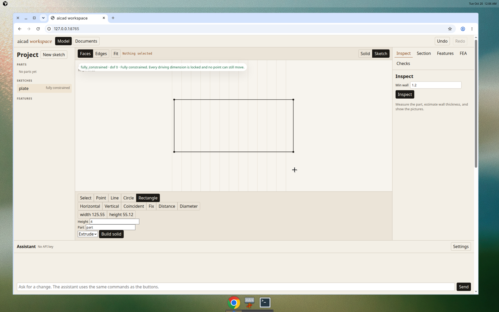
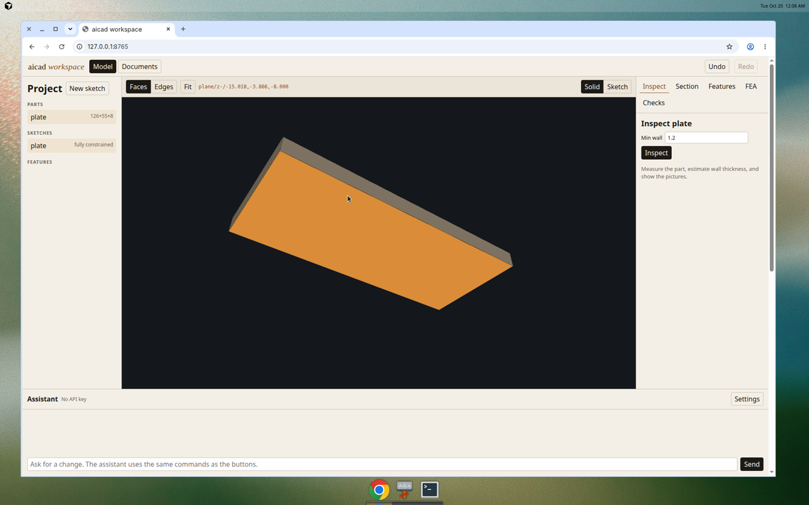
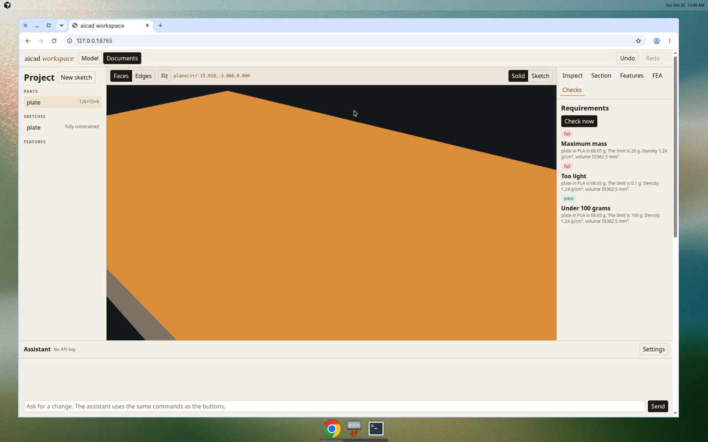
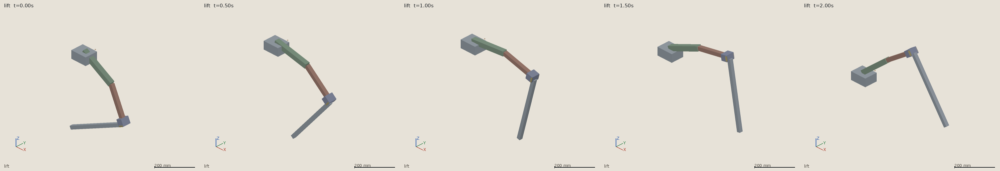
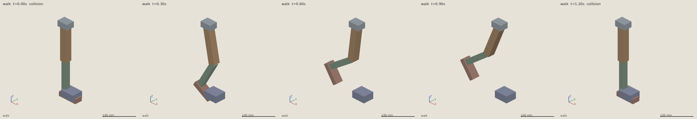
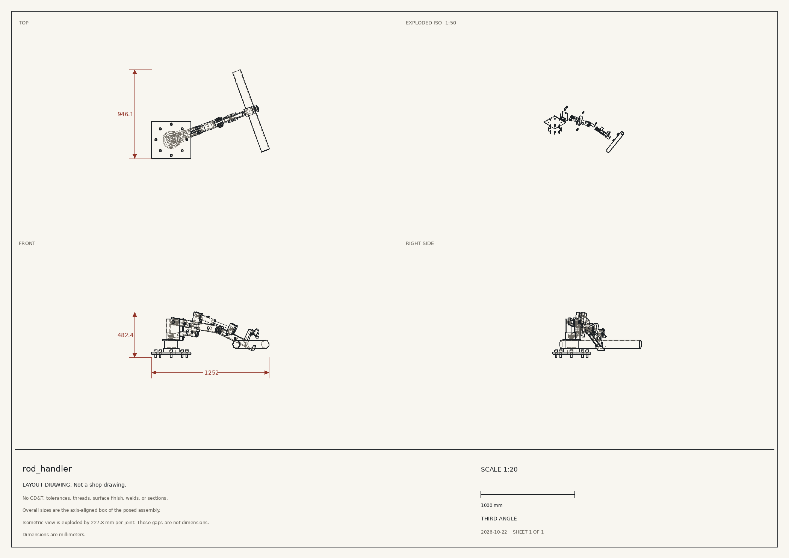
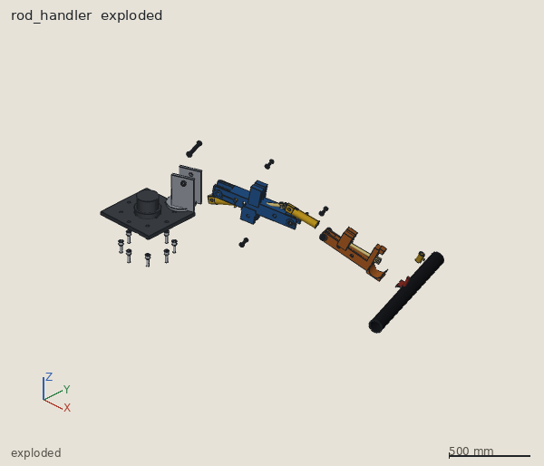
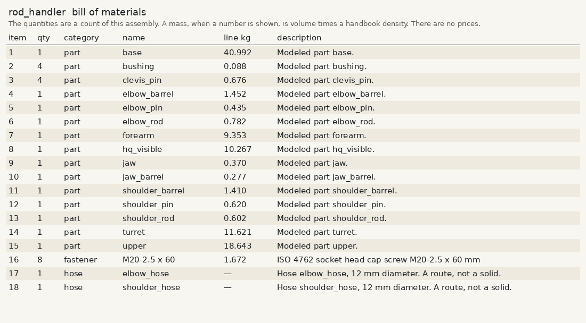
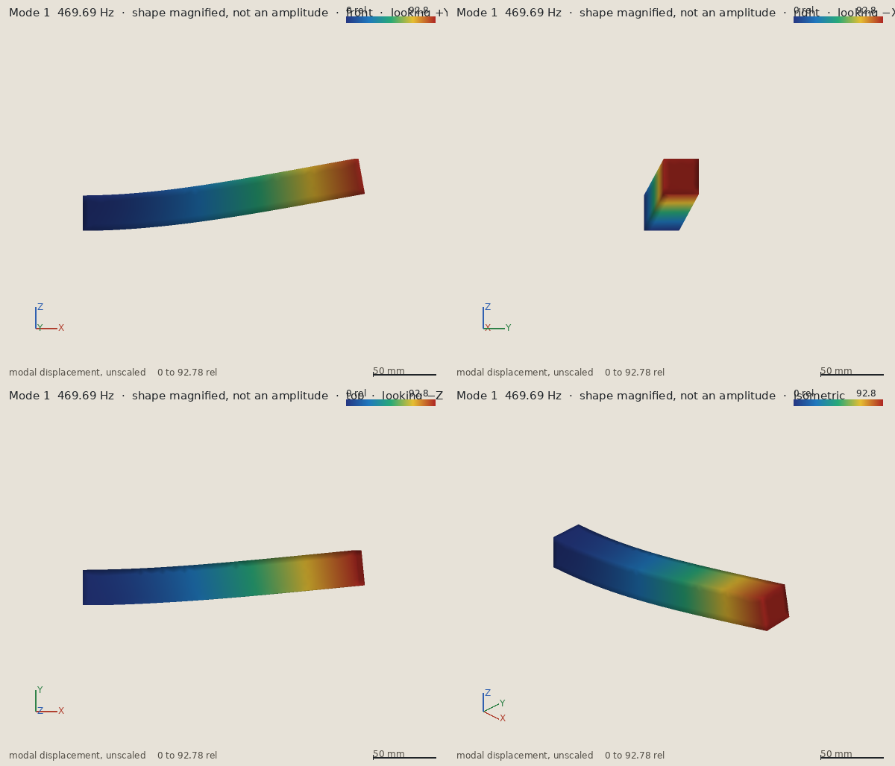
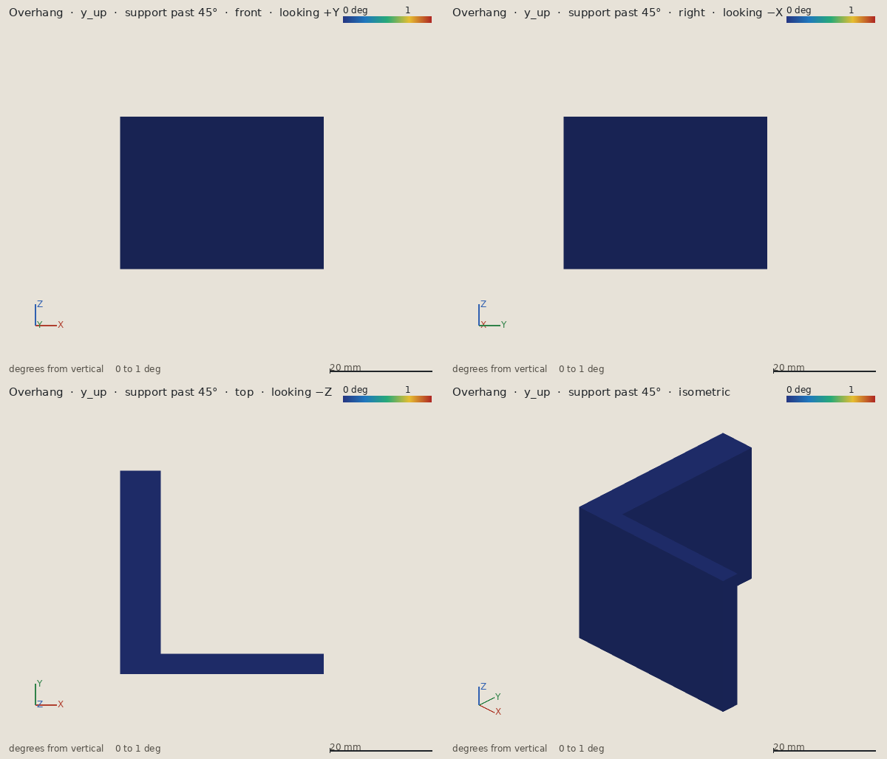

# ai-first-cad

A cad software designed with ai assistants in mind.

# aicad

[](LICENSE)

A CAD tool built so an assistant can use it as well as a person can.

Today an assistant writing CAD code (OpenSCAD, CadQuery, build123d) works blind. It emits a script and hopes the solid is the one you described. aicad is the missing perception loop: after each modeling step the assistant can look at the part and check it. The focus is hard-body mechanical parts, the kind you print or bolt onto a robot.

This is a small first version. It does not invent a geometry kernel. [build123d](https://github.com/gumyr/build123d) (OpenCascade) sits behind one module, `aicad.kernel`, so it can be swapped later. A person and an assistant share one command layer: the workspace app, the in-app chat, the CLI, the Python API, and the MCP server all call the same operations on the same document.

New to CAD, or new to this repo? Read [START_HERE.md](START_HERE.md). It is a plain-language tour: install on Windows or Mac, open the app, connect an assistant, and walk the examples.

Report a vulnerability in private. The steps are in [SECURITY.md](SECURITY.md).


## What you can do

- Plan a design before modeling it. Research with sources, a rough dimensioned blueprint of blocks, assumptions, and open questions stay with the project. You approve the plan in the Plan panel. The assistant cannot approve it, and modeling or simulation started from that plan waits until you do. See [Plan & Sketch](docs/PLAN_AND_SKETCH.md).
- Describe a 2D profile the way a sketcher does: points, lines, arcs, and circles, plus geometric and dimensional constraints. SolveSpace solves it and reports whether it is fully constrained, still free, or conflicting. Extrude, revolve, or cut the solved profile into a solid. Change a named dimension and the solid rebuilds.
- Create or replace a part by running a build123d script, or with a short list of `add` / `cut` boxes and cylinders.
- Optionally record each boolean step with `feature.add` / `feature.cut`, and see how much of an added solid was already buried inside the part.
- Keep a document of named parts and sketches on disk. The script, the operation list, the sketch plus its build steps, a catalog part, or a copied STEP file is the source. Opening the workspace rebuilds the solids.
- Measure a part: bounding box, volume, surface area, center of mass, face and edge counts, and whether the solid is valid and watertight.
- Render it headless, with no GPU and no display: front, back, left, right, top, bottom, isometric, one contact sheet, and a planar section. The MCP tools return those pictures so the assistant can see them.
- Export STEP and STL. Import a STEP file and place it.
- Search a small catalog of real screws, nuts, washers, and ball bearings, insert one, and check clearance against your part.
- Estimate minimum wall thickness from rays and from cross-sections, and compare it with a threshold. The report says which method produced the number.
- Check interference or clearance between two parts.
- Run a linear static check. Pick a material (PLA, PETG, ABS, nylon, aluminum 6061, or mild steel), hold faces and apply forces, pressures, or bolt loads by describing the face, and read the peak von Mises stress, the peak displacement, the minimum safety factor, and a pass/fail against a target. Stress and displacement pictures come back from several angles.
- Open the workspace with `aicad app` and edit the same document in the browser: open and save a project folder, orbit the parts, move one, pick a face or an edge by the reference an assistant uses, measure between two clicks, draw a constrained sketch, extrude or revolve or cut it, change a dimension or another size on the solid, undo, and read inspection, section, feature, and FEA panels. Live mode follows an assistant's edits. A chat panel drives those same commands with an API key you keep on the machine. Each project also has markdown notes and structured requirements that pass or fail against the current solid.
- Assemble parts you already modeled, including catalog parts, with fixed, revolute, prismatic, and cylindrical joints, plus gear and planar linkage relations. Name poses, sweep a motion, and see where the moving solids collide. Route a cable or a hose through clips and check length, bend radius, and pinching. Estimate the joint torque and the hydraulic or electric power that motion needs.
- Find natural frequencies, compare them with a motor or a pump, and rate a bolted joint for slip and vibration loosening.
- Turn a part for printing, see the faces that need support, and check the oriented size against a Bambu A1, P1, X1, Prusa MK4, or Ender 3. A requirement kind `fits_printer` is that check. PrusaSlicer or OrcaSlicer, when installed, adds time and filament grams.
- Export an assembly as URDF and MJCF, with meshes, joint limits, masses, and inertias. MuJoCo, when installed, loads the file and steps it.

Units are millimeters. Forces are newtons, so a stress from the solver is in megapascals. Joint torque is newton-meters. Hydraulic pressure is megapascals.

## Install

You need Python 3.11 or newer. On Windows and Mac, use 3.11 if you can: the sketch solver has a ready-made package for 3.11, and 3.12 needs a C++ compiler. The OpenCascade wheel that build123d depends on is large. From the project folder, one command creates a virtual environment and installs aicad, including the robot extra:

```bash
python install.py
```

On Ubuntu or Debian, `python -m venv` needs the `python3-venv` package (`sudo apt-get install -y python3-venv`) before that first command. The package that matches your Python, such as `python3.12-venv`, is the one that provides `ensurepip`.

On Windows, if `python` is not found, use `py install.py`. On a Mac, if `python` is not 3.11 or newer, use `python3 install.py`. The command prints how to turn the environment on. Then `pytest` runs the tests from that environment.

The sketch solver is [python-solvespace](https://github.com/KmolYuan/solvespace), a wrapper around the SolveSpace geometric constraint solver. That solver is GPL-3.0-or-later. aicad is AGPL-3.0-or-later, and that GPL solver can be combined with it. If pip has no wheel for your Python, it compiles the solver and needs a C++ compiler plus Python headers (`python3-dev` and `g++` on Debian or Ubuntu; `python install.py` installs those when `sudo` works without a password).

The mechanics solver is [CalculiX](https://www.calculix.de/) (`ccx`), which is GPL-2.0-only and runs as a separate program. Meshing uses [Gmsh](https://gmsh.info/), GPL-2.0-or-later, through the `gmsh` Python module that pip installs with aicad. aicad does not download CalculiX. `python install.py` looks for `ccx` and, if it is missing, prints the command for this operating system:

- Ubuntu or Debian: `sudo apt-get install -y calculix-ccx` (the installer runs this itself when `sudo` does not need a password)
- Fedora: `sudo dnf install -y calculix`
- Mac: `brew install costerwi/homebrew-calculix/calculix-ccx`
- Windows, Mac, or Linux with conda: `conda install conda-forge::calculix`
- Windows without conda: a build from the [CalculiX-Windows releases](https://github.com/calculix/CalculiX-Windows/releases), with the folder that contains `ccx.exe` on PATH

`aicad fea` reports a clear error when `ccx` is missing. The tests skip in that case.

## Try the motor mount

The worked example is a 72 × 52 × 4 mm plate with a boss, a 16 mm bore, four motor screws, four frame holes, a cable slot on the +Y edge, and three gussets that brace the boss to the plate. The plate outline, the bore, the boss, and both hole patterns are a constrained sketch: the four motor screws are "evenly spaced on a 24 mm circle, starting at 45°", and each frame hole is 6 mm inside the edges. `examples/shaft.py` is a 15.6 mm shaft meant to pass through that bore.

An earlier version used two ribs centered at x = ±16 mm. Those ribs span x = 14..18 mm while the boss radius is 18 mm, so most of each rib was already inside the boss. Nothing in a bounding box would say that. `examples/motor_mount_buried_ribs.py` is that design, kept so the feature report can flag it. `examples/feature_report.json` is the before/after: the ribs are redundant, the gussets are not. A cut through the old boss at y = 0 does not show a rib. The cut at y = 13 shows the little end that sticks out.


```bash
python examples/motor_mount.py
```

That writes `examples/renders/` and `examples/motor_mount_report.json`. The same checks from the CLI:

```bash
aicad run examples/motor_mount.py --name motor_mount --workspace ./aicad_workspace
aicad run examples/shaft.py --name shaft --workspace ./aicad_workspace
aicad inspect motor_mount --min-wall 1.2 --workspace ./aicad_workspace
aicad section motor_mount --axis y --offset 0 --workspace ./aicad_workspace
aicad features motor_mount --workspace ./aicad_workspace
aicad check-clearance motor_mount shaft --min 0.1 --workspace ./aicad_workspace
aicad check-packaging --envelope '{"shape":"box","size":[80,60,30],"center":[0,0,15]}' --parts motor_mount,shaft --min 0.5 --workspace ./aicad_workspace
aicad catalog "M3 screw" --workspace ./aicad_workspace
aicad insert m3 --kind socket_head_cap_screw --size M3-0.5 --length 12 --at 0,0,12 --workspace ./aicad_workspace
aicad export motor_mount --format step --out motor_mount.step --workspace ./aicad_workspace
aicad export motor_mount --format stl --out motor_mount.stl --workspace ./aicad_workspace
```

The same plate as a sketch, then a longer plate by changing one dimension:

```bash
aicad sketch plate --file examples/plate_sketch.json --workspace ./aicad_workspace
aicad sketch-part pad plate --steps examples/plate_steps.json --workspace ./aicad_workspace
aicad dimension plate base_length 90 --workspace ./aicad_workspace
aicad sketch plate --workspace ./aicad_workspace
```

The same bracket, under a motor load, compared with the buried-rib version:

```bash
python examples/mechanics_compare.py
aicad run examples/motor_mount.py --name motor_mount --workspace ./aicad_workspace
aicad faces motor_mount --workspace ./aicad_workspace
aicad fea motor_mount --file examples/motor_load.json --workspace ./aicad_workspace
aicad materials --workspace ./aicad_workspace
```

`examples/motor_load.json` holds the four frame holes, 100 N in +X on the bore, and 30 N down on the boss top. The comparison writes `examples/mechanics_report.json`.


`aicad sketch plate` prints the solved coordinates and writes a PNG with the dimensions labeled. `base_length` is the name from the constraint, not a variable in the solid.

On the build that produced the pictures in this repo, inspect reported:

| Check | Result |
| --- | --- |
| Bounding box | 72 × 52 × 12 mm |
| Volume | 20426 mm³ |
| Valid and watertight | yes, one solid |
| Sketch | fully constrained, 0 degrees of freedom. Bore is Ø16 ±0.05 |
| `base_length` 72 → 90 | the same part rebuilds at 24170 mm³ |
| Estimated minimum wall | 2.4 mm, from ray samples (sections estimated 2.6 mm) |
| Against a 1.2 mm print rule | pass |
| Gap to the 15.6 mm shaft | 0.2 mm, no interference |
| Gussets | not flagged; 24% to 35% of each gusset was already inside the boss |
| Old ribs | flagged; 55% of each rib was already inside the boss |
| Motor load, PLA, safety factor 2 | both pass. Gussets: 5.43 MPa, safety factor 9.21, 0.0186 mm. Buried ribs: 5.57 MPa, safety factor 8.98, 0.0168 mm |
| Where the peak is | a frame-hole edge on both parts, around (28.4, ±19.3, 0) |

The wall number is a sample, not a proof. The stress numbers are one linear mesh of this load, not a certified allowable. See [Limitations](#limitations).

## Mechanics

`solve_mechanics` (CLI: `aicad fea`) meshes the solid with Gmsh and solves linear static elasticity with CalculiX. You name a material and you name faces. A boolean does not keep the feature name from the script, so a face is a plane normal, a cylinder radius, a point, or an index from `describe_faces`.

```json
{
  "material": "pla",
  "mesh_size_mm": 1.5,
  "target_safety_factor": 2,
  "fixes": [
    {"name": "frame_bolts", "select": {"kind": "cylinder", "radius": 1.7, "axis": [0, 0, 1]}}
  ],
  "loads": [
    {"name": "shaft_side", "type": "force", "vector": [100, 0, 0],
     "select": {"kind": "cylinder", "radius": 8, "axis": [0, 0, 1]}},
    {"name": "motor_axial", "type": "force", "vector": [0, 0, -30],
     "select": {"kind": "plane", "normal": [0, 0, 1], "at": [0, 0, 12]}}
  ]
}
```

`force` is a total in newtons, shared equally by the nodes on the selected faces. `pressure` is in MPa and a positive value pushes into the face. `bolt` is `axial` newtons along the hole axis (positive follows the axis, upward for a vertical hole). `each: true` applies a force or a bolt load once per face. Omit `at` on a cylinder to take every hole of that radius. The default radius tolerance is 0.05 mm, so 1.7 and 1.6 stay distinct holes.

The report returns the peak nodal von Mises stress, the peak displacement, and the minimum safety factor (strength divided by that peak) with the node where it occurs. Metals are compared with yield. Plastics are compared with the tensile number. Pictures are front, right, top, isometric, and a contact sheet, for stress and for displacement. Blue is low and red is high. Each picture is scaled to itself, and the title carries the maximum, so two brackets are compared by the numbers in the title.

`review.status` is `pass`, `fail`, or `inconclusive`. Pass means the safety factor meets the target on a mesh that is not flagged as coarse. A coarse mesh, a thin region whose elements are much smaller than the mesh size, or a fallback from quadratic tetrahedra to linear ones, keeps a high safety factor at `inconclusive`. A safety factor under the target is `fail` even on a coarse mesh, and the warning says the mesh is a hint. Overstressed regions are candidates for added material. Regions whose stress is a small fraction of the peak are candidates for removed material.

Every report states the material, the loads, the supports, the mesh size, and that the model is linear and isotropic. A printed material uses an in-plane strength and the report says a printed part is weaker across layers, often about half. The same sentence is present for a metal, with no layer reduction applied. Warnings cover a part with nothing fixed, a load that matches no face, a load that shares nodes with the support, and a mesh that is very coarse or larger than a selected hole.

On the example load both brackets pass with a safety factor near 9. The gusseted peak is 5.43 MPa and the buried-rib peak is 5.57 MPa, both at a frame-hole edge. The ribs and the gussets are not what sets the safety factor for this load. Most of the volume is far below the peak, so the design review marks quiet regions as candidates for removed material, or as a sign that this load is smaller than the part was sized for. A load about four times larger would bring the safety factor down near the target of 2, because the model is linear.

## Workspace

Start with the `aicad` command. Do not run `python -m aicad` from a project folder. For development, use `python -P -m aicad`.

```bash
aicad app --workspace ./aicad_workspace
```







That starts a local server and opens the browser. `--no-browser` leaves the tab to you, and `--host` / `--port` change the bind address (the default is `http://127.0.0.1:8765`). The page is static HTML, CSS, and JavaScript. The Python process owns the document, so the same server can later sit behind a desktop shell such as Tauri. This version does not package that shell.

Open, Save, and Save As use the project folder. Save writes the folder that is open. Save As copies it. Recent projects are remembered on this computer, next to the assistant settings. Undo and Redo remain the history of the open folder.

The model view shows every part. Move drags the selected part, or type X, Y, and Z. A size under Shape is a number the solid was built from: an operation size, a sketch dimension, an extrude height, or a catalog length. Sliding it rebuilds the solid. A script or an imported STEP file can be moved, and it has no size to slide. Measure takes two clicks for a distance and a third click for the angle at the second point.

Live, in the header, follows an assistant. A new or changed part shows up, the camera frames it, the part is highlighted, and a short feed says what the assistant did. Turning Live off leaves the camera where you put it.

Every button, sketch click, dimension edit, move, measurement, and undo goes through `Workspace.execute`, which is the same registry the MCP tools call. An external assistant attaches to the running app and edits the document the browser is showing:

```bash
aicad serve --connect http://127.0.0.1:8765
```

The viewport listens for those commands and refreshes. A face click and `describe_faces` publish the same string, for example `plane/z+/0.000,0.000,4.000` or `cylinder/r1.7/z+/30.000,-20.000,2.000`. `set_selection` and a mechanics selector both accept that string as `{"ref": "..."}`.

The sketch tools draw points, lines, circles, and rectangles, then add horizontal, vertical, coincident, fix, distance, and diameter constraints. The status line says fully constrained, under-constrained, or over-constrained, with the remaining degrees of freedom. Named dimensions sit on the toolbar; editing one calls `set_dimension` and regenerates every solid made from that sketch. Extrude, revolve, and cut use the solved profile.

The side panels run `inspect_part`, `section_part`, `feature_report`, and `solve_mechanics`, and they keep the picture from the revision that produced it. The Checks tab and the Documents page share `requirements.json`:

| Kind | What it compares |
| --- | --- |
| `max_mass` | Volume times a library density, in grams. |
| `fits_build_volume` | The part's sorted size against a printer volume, so the part may be turned to fit. |
| `fits_printer` | The oriented size against a named printer (`bambu_a1`, `prusa_mk4`, `ender_3`, …). Height is the oriented Z. The footprint may swap X and Y. `orientation` is `best` or `z_up`. |
| `min_wall` | The wall-thickness estimate. It stays unchecked until you press Check now. |
| `min_safety_factor` | A linear static solve. The setup is the same object `solve_mechanics` uses, and a face `ref` is a valid selector. It stays unchecked until you ask for the solve. |

`documents/requirements.md` and `documents/decisions.md` are ordinary markdown. Undo restores the solids, the notes, and the requirements together.

The assistant panel takes an OpenAI-compatible endpoint or Anthropic. Settings go to `~/.config/aicad/settings.json`, or to `$AICAD_SETTINGS`, with mode `0600`. The key is not written into the project. The chat model calls the same tools, including `get_requirements` and `check_requirements`.

## Assemblies, motion, cables, and power

```bash
python examples/rod_arm.py
aicad app --workspace examples/rod_arm_workspace
```





An assembly is a list of instances of parts that are already in the document, custom or from the catalog. Structural joints form a tree. One instance is grounded because nothing drives it. The joint types are:

| Type | Value | What moves |
| --- | --- | --- |
| `fixed` | ignored | The child is welded at the anchors. |
| `revolute` | degrees | The child spins about the axis. |
| `prismatic` | millimeters | The child slides along the axis. |
| `cylindrical` | degrees, plus `slide` in millimeters | Spin and slide on the same axis. |

`parent_anchor` and `child_anchor` are points in each part's local frame, in millimeters. `axis` is a direction in the parent. Limits clamp the value after relations run, and the report says when a command was held at a stop.

A gear is linear: driven = ratio × driver + offset. A linkage is a planar four-bar (`ground_mm`, `crank_mm`, `coupler_mm`, `rocker_mm`, branch `open` or `crossed`). It writes one angle from another. It does not close a spatial loop. A cylinder relation is the hydraulic case of that idea: from the driver angle it writes the barrel angle and the rod extension so the rod eye stays on the moving clevis. The joint tree stays a tree. Stroke limits are the prismatic joint's own limits.

Named poses store joint values. A motion is a sweep (`joint`, `start`, `end`, `frames`) or keyframes (`{"pose": "lift"}` or `{"joints": {"shoulder": -40}}`), with `samples` and `duration_s`. If the duration is omitted, rates use one second and the report says so. `run_motion` places every sample, reports interference between instances that are not joined to each other, and writes an isometric frame, a strip, and a GIF. The two sides of a joint are allowed to touch.

A motion study is the record of that kind of sweep for a later check to read. `duration_s` is the length of the timeline. `steps` is how many poses are solved, counting both ends. A driver is an expression in `t` (seconds), such as `90 * t`, or keyframes `{time_s, value}` with straight lines between them. A cylindrical joint can also drive `slide`. A coupling is a gear constraint on the study: the driven joint is `ratio * driver + offset`. Commands past a joint limit are held at the stop, and the stop is recorded. Pairs whose boxes are farther apart than `clearance_mm` are left alone. Every other pair is the boolean intersection of the modeled solids. An overlap reports the volume and the penetration depth. A gap shorter than the clearance reports the shortfall. The two sides of a joint are allowed to touch. `run_motion_study` returns schema `motion_study.v1`: the pose matrix of every part at every step, the collisions, and the limit hits. The module docstring in `aicad.motion_study` is the field list.

Cables and hoses are polylines through waypoints fixed on parts (`instance`, `at`, and whether that point is a clip). Each route has a diameter, a minimum bend radius, and a stiffness (`low`, `medium`, `high`, or newtons per unit strain). Through a motion the check reports length change, strain against the rest length, bend radius at each waypoint, pinching between the centerline and a moving solid, and a self-intersection of the route. Rest length is the authored value, or the length of the first frame. A shorter route is slack, not compression. Samples next to a waypoint are the clip seat and are not counted as a pinch of that part.

This is a kinematic model. The line does not sag, and clips do not slip. A later flexible-body model, a Cosserat rod or a chain of rigid segments with bending springs, would add sag, contact, and clip slip. It would still be checked against these length, bend, and gap limits.

Power is quasi-static. Gravity is 9.81 m/s² along −Z. Mass is the solid's volume times the material density, plus `payload_kg` at `payload_at` or at the center of mass. A revolute joint sees the moment of the supported weight about its axis. A prismatic joint sees the component of that weight along the slide. Inertia, friction, seal drag, and line loss are omitted, and the report says so. A gear, linkage, or cylinder relation reflects the driven load onto the driver when the driven joint has no actuator of its own. The cylinder's share is the change in barrel angle per degree of the driver.

A hydraulic cylinder turns that torque into force with `moment_arm_mm`. Extend uses the bore area. Retract uses bore minus rod. Pressure is force over area, in MPa. Flow is area times piston speed. Power is pressure times flow, divided by efficiency. One MPa·mm³/s is 0.001 W. The pump figure is the hydraulic energy over the motion duration, with no regeneration. An electric actuator divides joint torque by gear ratio and efficiency, then divides by the torque constant for current. Power is joint torque times speed, divided by efficiency. Braking energy is counted as spent. Battery watt-hours are that electric energy, and amp-hours divide by the stated voltage.

The same commands are `create_assembly`, `set_joint`, `set_pose`, `run_motion`, `run_motion_study`, `check_cables`, `estimate_power`, `solve_modal`, `solve_assembly_modal`, and `check_bolts` on the Python API, the MCP server, and the CLI:

```bash
aicad assemble rod_arm --file arm.json --workspace ./aicad_workspace
aicad joint rod_arm shoulder --value -40 --workspace ./aicad_workspace
aicad pose rod_arm lift --workspace ./aicad_workspace
aicad motion rod_arm --sequence lift --workspace ./aicad_workspace
aicad motion-study rod_arm --file study.json --workspace ./aicad_workspace
aicad cables rod_arm --sequence lift --workspace ./aicad_workspace
aicad power rod_arm --sequence lift --workspace ./aicad_workspace
```

In the workspace app the Assembly page lists joints, poses, and motions. Apply sets a joint. A pose or a motion runs the same command the assistant uses. Preview and Orbit show the posed solids. Cables, Power, Modes, and Bolt check open the reports, including the assumptions.

`examples/rod_arm.py` builds a simplified drill-rod handler: a base, a two-joint arm, a gripper whose jaws are geared together, an M3 washer used as a clip, a hydraulic hose, and a cable. An 8 kg payload sits on the rod, on top of the rod's own steel mass. From the reach pose to the lift pose the rod origin rises from −259 mm to 309 mm, and the arm does not collide with itself. The hose shortens by about 17 mm and stays slack. The cable grows by about 23 mm, strain 0.057, under its 0.15 limit. The tightest bend on either route is about 112 mm, against limits of 18 mm and 12 mm. Neither route pinches. The shoulder cylinder (20 mm bore, 50 mm moment arm) peaks at 45.1 N·m, 3.83 MPa, and 32 W. The elbow cylinder (16 mm bore, 40 mm moment arm) peaks at 28.1 N·m, 4.65 MPa, and 8.6 W. Over the two-second lift the pump sees about 28 W mean and 17,600 mm³ of displaced fluid. A separate test leg runs a short walk cycle and collides with a block on the planted frames. The pictures are `examples/renders/rod_arm_strip.png`, `examples/renders/rod_arm.gif`, and `examples/renders/rod_leg_strip.png`. The numbers are in `examples/renders/rod_arm_report.json`.

`examples/rod_handler.py` is the same job drawn as a mechanism: a bolted slew base, plate links with lightening holes and gussets, pins and bushings, and a hydraulic cylinder on the shoulder, the elbow, and the jaw. The jaw closes on NQ and HQ rod. A cylinder relation keeps each rod eye on its clevis. The write-up of what the checks caught, and what changed, is [examples/rod_handler_notes.md](examples/rod_handler_notes.md).

The same assembly can be written out as a layout sheet, a parts count, and an exploded picture. These read the posed solids. They do not change a solver.

They are not buttons in the Workspace app yet. Ask your AI. It has the same three tools: `export_drawing`, `bill_of_materials`, and `exploded_view`. Or run the CLI:

```bash
aicad export-drawing rod_handler --exploded --workspace examples/rod_handler_workspace
aicad bill-of-materials rod_handler --workspace examples/rod_handler_workspace
aicad exploded-view rod_handler --workspace examples/rod_handler_workspace
```

The sheet is third-angle, A3, PDF and DXF, with the overall box of the posed assembly, a title block, and a scale. The usual ratios run from 10:1 to 1:1000. A larger assembly uses a smaller ratio, and the sheet says which one. It is a layout drawing. It has no GD&T, no tolerances, and no threads. The count is a CSV of parts, catalog fasteners, and hoses, written as UTF-8 with a byte order mark so Excel keeps the names. Quantities are exact. A mass is volume times a handbook density, and there are no prices. The exploded picture pulls a slide along its axis, a hinge off its pin, and a catalog fastener out along its axis. The gap is not a dimension, and the picture is not a disassembly procedure. A Windows reserved name such as `con` is written as `con_file`, and the report says so.

On the rod handler at its stored pose the sheet is 1:20, including the isometric, because that view fits. The exploded isometric is 1:50 so the opened joints fit, and the view says so. The overall box is 1252 by 946.1 by 482.4 mm. That box is the space the swung arm occupies, not the length of a link. The list is 18 lines and 31 items, including eight M20 screws as one line and two hoses with no mass. The picture opens each joint by 227.8 mm.







## Vibration and bolted joints

```bash
python examples/vibration_arm.py
```



`solve_modal` (CLI: `aicad modal`) meshes one solid and runs CalculiX `*FREQUENCY`. You hold faces the same way a static solve does. The report lists natural frequencies and writes a magnified mode shape. The color is the unscaled eigenvector. The title says the shape is magnified, because a mass-normalized mode is not an operating deflection.

An excitation is a running speed. `kind` is `motor`, `spindle`, `drill`, `engine`, or `pump`, with `rpm` or `hz`. Rotating sources are checked at harmonics 1, 2, and 3. A pump is checked at 1 and 2. A natural frequency within 10% of one of those lines is a resonance. The suggestion is to stiffen (a rib, a taller section, a shorter span), add mass, change the geometry, or change the running speed, depending on which side of the line the mode sits.

`solve_assembly_modal` (CLI: `aicad modal-assembly`) poses the assembly, skips fasteners and other parts under 2% of the largest volume, and ties each joint with a few translation equations. If you omit the supports, the grounded instance is held on its lowest downward face, and the report says that face was chosen automatically. A revolute is locked at the pose. It does not flex, so these frequencies are an upper bound on a real pin.

A harmonic block is a single-mode oscillator with a damping ratio you supply (0.02 if you omit it). A random block is Miles' equation on a flat acceleration spectrum. `check_fatigue` (CLI: `aicad fatigue`) is a Goodman check of a stress amplitude you supply against an estimated endurance limit. Steel uses half the ultimate strength, then surface and size factors. Aluminum is called out as having no true endurance limit. None of the three is a second finite-element solve, and every report says so.

`check_bolts` (CLI: `aicad bolts`) is for a fastener size from the catalog, or for a screw already in the document. It recommends a preload (70% of proof by default) and a tightening torque `K·F·d` for dry, zinc, lubricated, or threadlocker friction. It then compares the residual clamp with the external axial load and the friction capacity with the transverse shear. Slip margin below 1 means the plates slide. That is the usual way a nut walks open under vibration, and it happens while the bolt is still below yield. The report also checks thread stripping and bolt yield. Intense vibration raises the rating when the slip margin is only modest. Countermeasures are listed with what they actually do: more preload and a longer grip protect the clamp; a nyloc nut, wedge-locking washers, threadlocker, and safety wire resist nut rotation and do not create clamp force by themselves.

```bash
aicad modal upper_link --file modal.json --workspace ./aicad_workspace
aicad modal-assembly rod_arm --file modal.json --workspace ./aicad_workspace
aicad bolts --file joint.json --workspace ./aicad_workspace
aicad fatigue --file fatigue.json --workspace ./aicad_workspace
```

The part page has Vibration and Bolts tabs. Fix selection uses the face you picked. The Assembly page has Modes, with a drill rpm, and Bolt check. Both run the same commands the assistant uses.

`examples/vibration_arm.py` reuses the rod-handling arm. The upper link, aluminum, is held at the shoulder end. A drill rotary at 120 rpm (2 Hz, and its second and third harmonics) is clear of the link. A hydraulic pump is then placed at 97% of the computed first flexible frequency so the report flags that line and suggests a change. The same two sources are declared for the posed arm, with the joints locked. Four M8-8.8 bolts are checked as the base flange under intense vibration: 1000 N axial and 2500 N shear each, friction 0.14, 20 mm grip. The slip margin is below 1 and the yield margin stays above 1, which is the loosening case. An M12-10.9 with 800 N of shear is the contrast that still holds. A separate fatigue line uses 90 MPa alternating and 40 MPa mean on machined mild steel and lands under a factor of 2. The numbers are in `examples/renders/vibration_report.json`.

## Print prep

```bash
python examples/print_and_robot.py
aicad print shelf --orientation best --printer prusa_mk4 --workspace examples/print_workspace
```




`check_print` (CLI: `aicad print`) turns the solid so one modeled axis points up, colors faces by how far they lean from vertical, and drops the face that sits on the bed from the support area. Best means the smallest support area, then the shorter part. The six poses are `z_up`, `z_down`, `x_up`, `x_down`, `y_up`, and `y_down`. A diagonal pose is not searched.

Each pose is checked against the published beds: Bambu A1, P1, and X1 are 256 mm cubes, the A1 mini is 180, the Prusa MK4 is 250×210×220, and the Ender 3 is 220×220×250. Height is the oriented Z. The footprint may swap X and Y.

`fits_printer` is the requirements-table row for that check. Pass `printer` (`ender_3`, `a1`, `mk4`, …) and an optional `orientation`.

If `prusa-slicer` or `orca-slicer` is on PATH and `slice` is true, the report adds the gcode comment for time, grams, and cost. Filament density 1.24 g/cm³ is passed so a profile with no density does not report 0 g. `price_per_kg` fills in a cost when the gcode has none. A missing slicer is a skip, and the overhang map still stands. On the shelf in the example, PrusaSlicer 2.7 with its default profile reported about 31 min and 9.1 g for the modeled pose, and about 31 min and 9.8 g after the turn, at $20/kg.

## Robot export

```bash
aicad robot arm --out examples/robot_arm --workspace examples/print_workspace
```

`export_robot` (CLI: `aicad robot`) writes `robot.urdf`, `robot.xml` (MJCF), and `meshes/*.stl`. Meshes stay in millimeters and the robot file scales them by 0.001. Mass is kilograms. Inertia is about the center of mass, in kg·m², including a `payload_kg` as a point mass. Joint origins are the pose at value 0. Revolute limits are radians in the URDF and degrees in the MJCF. A cylindrical joint becomes a revolute plus a prismatic. Gear, linkage, and cylinder relations are XML comments. A world link fixes every grounded part. Effort and velocity are placeholders.

When MuJoCo is installed (`pip install -e ".[robot]"`), the export loads the MJCF and steps it. PyBullet is used the same way when it is installed. The example arm's shoulder runs from −45° to 90°, and MuJoCo loaded that file. The Assembly page button **Export robot** calls the same command.

## Connect an assistant

`aicad serve` speaks [MCP](https://modelcontextprotocol.io) over stdio. The tools are the same operations as the CLI and the workspace app. The short connect guide, including a generic MCP client, is [docs/CONNECT.md](docs/CONNECT.md). One worked session is [docs/EXAMPLE_SESSION.md](docs/EXAMPLE_SESSION.md).

Cursor (`~/.cursor/mcp.json`, or the project's `.cursor/mcp.json`):

```json
{
  "mcpServers": {
    "aicad": {
      "command": "aicad",
      "args": ["serve", "--workspace", "/absolute/path/to/aicad_workspace"]
    }
  }
}
```

Claude Desktop:

```json
{
  "mcpServers": {
    "aicad": {
      "command": "/absolute/path/to/.venv/bin/aicad",
      "args": ["serve", "--workspace", "/absolute/path/to/aicad_workspace"]
    }
  }
}
```

Use the virtualenv's `aicad` if it is not already on the assistant's `PATH`. The workspace directory is the session. It holds `session.json`, rendered PNGs, exports, and any STEP files you import.

A resource at `aicad://guide` repeats the script rules below. The server instructions tell the assistant to call `inspect_part` after every edit and to look at the pictures.

### Tools

| Tool | What it does |
| --- | --- |
| `create_sketch` / `get_sketch` | Solve a sketch. The report says fully constrained, under-constrained (which entities can still move), or over-constrained (which constraints conflict). The image has the dimensions labeled. |
| `set_dimension` | Change one named dimension, re-solve, and rebuild every part made from that sketch. |
| `create_part_from_sketch` | Extrude, revolve, or cut a solved sketch. Also `cut_box` and `gusset`. |
| `create_part_from_script` | Run a build123d script. The solid must be assigned to `part`. |
| `create_part_from_ops` | Build from a list of add/cut boxes and cylinders. |
| `update_part_script` / `update_part_ops` | Replace a part. A failed rebuild keeps the previous solid. |
| `import_step` | Copy a STEP file in as a named part (a McMaster download, a motor, a plate). |
| `place_part` | Move a part. Rotation is degrees about X, Y, Z, then the translation. It replaces the previous placement. |
| `search_parts` | Find a socket-head screw, hex nut, plain washer, or deep-groove ball bearing. `608` is the 8×22×7 bearing. |
| `insert_standard_part` | Insert one catalog part and place it. Screws need `length` (shank under the head, mm). |
| `create_gear` | Spur, helical, straight bevel, or spiral bevel gear from module, tooth count, and face width. |
| `section_part` | A planar cross-section: an image, the cut area, and the outline. Axis plus offset, or an origin and a normal. |
| `feature_report` | For each boolean step, how much material was new, buried, or actually removed. |
| `inspect_part` | Measure, estimate wall thickness, report feature contribution, and return the pictures. Call this after every edit. |
| `measure_part` | Bounding box, volume, area, center of mass, counts, valid, watertight. |
| `render_part` | The standard views and the contact sheet, as images. |
| `check_wall_thickness` | Ray estimate and section estimate. The minimum is scored against a threshold in mm, and `method` says which one won. |
| `check_clearance` | Overlap volume, or the gap between two parts. |
| `check_packaging` | Whether parts fit inside an envelope, with wall clearance, protrusion, and part-to-part overlap. |
| `export_part` | Write STEP or STL. |
| `list_parts` / `get_part_source` / `delete_part` | Document housekeeping. |
| `list_materials` | PLA, PETG, ABS, nylon, aluminum 6061, and mild steel, with the modulus and strength the solver will use. |
| `describe_faces` / `describe_edges` | Faces and edges, each with a stable `ref` the viewport also uses. A selector may be `{"ref": "plane/z+/0,0,4"}`. |
| `solve_mechanics` | Linear static solve. Returns the safety factor, the design review, the assumptions, and stress and displacement pictures. |
| `solve_modal` / `solve_assembly_modal` | Natural frequencies, magnified mode shapes, and a resonance check against rpm or Hz and harmonics. |
| `check_bolts` | Preload, torque, slip margin, stripping, yield, and a vibration-loosening rating. |
| `check_fatigue` | Goodman check of a stated stress amplitude against an estimated endurance limit. |
| `check_print` / `list_printers` | Overhang map, a suggested orientation, printer fit, and a slicer estimate when PrusaSlicer or OrcaSlicer is installed. |
| `export_robot` | URDF and MJCF for an assembly, with meshes, limits, masses, and inertias. |
| `set_selection` / `get_state` | The current face and edge selection, plus parts, sketches, checks, and the latest panels. |
| `list_documents` / `read_document` / `write_document` | The project's markdown notes. |
| `get_requirements` / `set_requirements` / `check_requirements` | Structured requirements and their pass, fail, or unchecked state. |
| `create_assembly` / `update_assembly` / `get_assembly` / `list_assemblies` | Place parts, replace a spec (a spec that does not solve leaves the previous assembly), and read joint values. |
| `set_joint` / `set_pose` / `run_motion` / `render_assembly` | Move an assembly, sweep a motion, and render the pose. Motion and the assembly render return pictures. |
| `run_motion_study` | Drive joints from expressions or keyframes, apply gear couplings, and report collisions and joint-limit violations. The record is `motion_study.v1`. |
| `check_cables` / `estimate_power` | Cable length and strain, and a quasi-static power estimate. Read the assumptions. |
| `list_sketches` / `update_sketch` / `update_part_from_sketch` | Sketch names, a replaced sketch spec, and a solid rebuilt from it. |
| `session_payload` / `replace_session` / `save_project` / `open_project` | Read or replace the saved document, confirm `session.json`, or switch project folder. Opening does not run scripts. |
| `undo` / `redo` / `delete_document` / `mesh_part` | The same history and notes as the app. `mesh_part` is a summary of face and edge refs, not the vertex arrays. |
| `assembly_mesh` | A short mesh summary. `full` true includes the vertex arrays. |
| `run_design_script` / `design_script_status` | One Python program against the project, after you allow it. The status tool does not turn it on. |
| `aicad://parts`, `aicad://assemblies`, `aicad://sketches`, `aicad://results`, `aicad://session` | The same project, as resources. `aicad://parts/{name}` and `aicad://assemblies/{name}` open one of them. |

`render_part` and `inspect_part` return PNG image blocks plus a JSON report. The assistant should look at the contact sheet, not only the numbers.

## Writing a part

A script is ordinary Python. `build123d` and `math` are already imported. End by assigning the solid to `part`.

```python
base = Pos(0, 0, 2) * Box(60, 40, 4)
boss = Pos(0, 0, 6) * Cylinder(12, 8)
part = base + boss
part -= Pos(0, 0, 6) * Cylinder(4, 20)  # shaft bore
```

`part = a + b` fuses. `part -= tool` cuts. A sketch or a curve is rejected: a part has to have volume. A script that never mentions `feature` is unchanged.

To record what each step actually did, use the `feature` object that the runner defines:

```python
bracket = feature.add("base", Pos(0, 0, 2) * Box(60, 40, 4))
bracket = feature.add("boss", Pos(0, 0, 6) * Cylinder(12, 8))
bracket = feature.cut("bore", Pos(0, 0, 6) * Cylinder(4, 20))
part = bracket
```

An added feature is flagged when at least half of its volume was already inside the part. A cut is flagged when it removes nothing. A through hole whose cutter sticks out of the part is not flagged; `removed_fraction` still says how much of the cutter was inside. `part = feature.result` is the same solid. `inspect_part` includes this report.

The same plate as operations, which is enough for a stack of boxes and holes. Operations are always tracked. An optional `name` shows up in the report:

```json
[
  {"op": "add", "shape": "box", "size": [60, 40, 4], "center": [0, 0, 2]},
  {"op": "cut", "shape": "cylinder", "radius": 4, "height": 10, "center": [0, 0, 2]}
]
```

Boxes are axis-aligned. A cylinder takes `radius`, `height`, an optional `center`, and an optional `axis` (default `[0, 0, 1]`). The first operation has to be `add`.

## Sketches

A sketch is how you say "four holes on a 24 mm circle" without computing the coordinates. You name points, lines, arcs, and circles, then add constraints. Initial `at` values are a guess the solver may move. `fix` locks a point where you put it.

```python
from aicad import Document, Sketch

sketch = (
    Sketch()
    .point("origin", 0, 0).fix("origin")
    .point("b0", 8, 8).point("b1", -8, 8).point("b2", -8, -8).point("b3", 8, -8)
    .pattern_on_circle("origin", ["b0", "b1", "b2", "b3"], diameter=24, start_angle=45, name="bolt_circle")
    .circle("bore", "origin", 8)
    .diameter("bore", 16, name="bore_diameter", tolerance=0.05)
)
document = Document("./aicad_workspace")
report = document.create_sketch("holes", sketch)
```

`report.status` is `fully_constrained`, `under_constrained`, or `over_constrained`. `report.dof` is how much is still free. `report.free` names the entities that can still move, and `report.conflicts` names the constraints that disagree. A conflicting sketch is stored so you can read that report; it is not extruded.

Constraints: `fix`, `coincident`, `parallel`, `perpendicular`, `tangent`, `equal`, `horizontal`, `vertical`, `symmetric`, `midpoint`, `distance`, `angle`, `radius`, `diameter`, `pattern_on_circle`. A distance, diameter, radius, angle, or pattern can carry a `name` and a `tolerance` (`0.05`, or `{"plus": 0.05, "minus": 0.02}`). The tolerance is stored and printed (`Ø16 ±0.05`). It does not move the geometry. That is the hook for a drawing later.

A point-to-line distance is signed. Positive is to the right as you walk from the line's start to its end. A rectangle drawn counterclockwise has its interior on the negative side, so "6 mm in from the edge" is the distance −6.

`pattern_on_circle` puts the points on a construction circle of the given diameter, spaces them evenly, and, when you pass `start_angle`, locks the first point relative to the +X direction. List the points in order around the circle, and put each guess near where it should land.

Turn the solved sketch into a solid with steps. A part made this way rebuilds when you change a named dimension:

```python
document.create_part_from_sketch("pad", "plate", [
    {"op": "extrude", "points": ["sw", "se", "ne", "nw"], "height": 4, "name": "base"},
    {"op": "cut", "circle": "bore", "height": 8, "name": "bore"},
])
document.set_dimension("plate", "base_length", 90)
```

`extrude` and `cut` take `points` (ids, in order) or `circle`, plus `height` and an optional `z` for the bottom of the prism. `revolve` spins an XY profile about the sketch `x` or `y` axis; the profile has to stay on one side of that axis. `cut_box` and `gusset` are ordinary 3D numbers, not sketch dimensions, so editing them means replacing the step list. The motor-mount gussets and cable slot are those recipes. The plate, boss, bore, and holes are the sketch, so they follow `base_length`, `bolt_circle`, and the rest.

An under-constrained sketch still builds, from the solution the solver returned, and the inspect report carries a warning plus the free entities. An over-constrained or non-converged sketch does not build, and a dimension change that conflicts leaves the previous solid in place.

Views use Z up. The label on each picture says which way the camera is looking (`front` looks toward +Y). A small X/Y/Z triad is drawn on the view, and the footer carries the bounding box and a scale bar.

## How the checks work

A result is either a **verified check** or a **rough estimate**. A verified check is something the geometry kernel computes on the CAD model: volume, a gap, a collision at a sampled pose, the degrees of freedom of a sketch. A rough estimate samples the solid, meshes it, or multiplies by a handbook number: wall thickness, mass, stress, a frequency, a bolt torque, a print time. A report that mixes the two is labeled by the weaker one. The label, what it means, and the limits travel with the JSON, the Workspace panel, and a blueprint sheet under `renders/sheets`. A mesh that was simplified, or that dropped to linear tetrahedra, cannot be a pass, and a frequency from that mesh is not a clear and not a confirmed resonance. CalculiX is started as the separate `ccx` program. It is not linked into aicad.

**Watertight.** A part is watertight when build123d reports it valid and manifold: every edge belongs to exactly two faces, the solid has volume, and the OpenCascade shape check passes. That is the right meaning for a single closed body. `solid_count` tells you when the result is more than one body.

**Wall thickness.** Two estimates are computed. Rays start on a grid on each face and measure the distance to the next roughly parallel face. Sections slice the part at 25%, 50%, and 75% of its extent along X, Y, and Z and measure the width between roughly parallel edges in that plane. The smaller number is the estimate. `method` is `ray`, `section`, or `ray+section` when they agree within 0.05 mm. Both numbers are in the report. A requested `section_part` also reports the minimum width in that one plane, which is how you look inside a boss.

**Feature contribution.** For an add, new material is the volume increase and buried material is the rest of the tool. For a cut, the report is the volume that disappeared. This is why the buried ribs are flagged and the gussets are not.

**Clearance.** The interference volume is the boolean intersection of the two solids. If they do not overlap, `min_distance_mm` is the gap between the surfaces, and the closest points are reported. The gap is not a penetration depth: overlapping parts report distance 0 and a volume.

**Packaging.** `check_packaging` tests whether each part lies inside an envelope, using the solid rather than its bounding box. The envelope is a part (a modeled solid or an imported STEP file), a primitive (`box`, `cylinder`, or `sphere`), or a 2D outline extruded between two limits along an axis. `min_clearance_mm` is the required gap to the envelope wall. The report gives pass or fail for each part, the smallest signed clearance and where it occurs, and, for a part that sticks out, the maximum protrusion and a point on the part. A positive clearance is a gap inside the wall, zero means the part touches the wall, and a negative clearance is the protrusion. Overlap between parts is the boolean intersection that also lies inside the envelope. The check fails if any part is too close to the wall or any overlap is reported. Pass `assembly` with `pose` or `joints` to use a posed assembly; that call does not change the stored pose, so the same check can be repeated at another joint position.

**Catalog parts.** Screws, nuts, washers, and bearings come from [bd_warehouse](https://github.com/gumyr/bd_warehouse), which builds them with build123d from published dimensions. A screw's shank points down (−Z) and the underside of the head sits on local z = 0. Nuts, washers, and bearings sit on z = 0 and grow toward +Z. Screws and nuts are built with `simple=True`, so the thread is not cut; a screw's modeled shank is near the minor diameter, and a clearance check against a hole uses that solid. `import_step` plus `place_part` is the path for a STEP file from McMaster-Carr or anywhere else.

**Gears.** `create_gear` builds an external spur, helical, straight bevel, or spiral bevel as a solid, and reports the pitch diameters, base diameter, cone angles, and contact ratio. Spur and helical teeth follow ISO 21771:2007 with an ISO 53:1998 basic rack. Straight and spiral bevel teeth use the intersecting-axis pitch cones of ISO 23509:2016 and the virtual cylindrical gear of ANSI/AGMA 2005-D03. A bore, a hub, a DIN 6885-1 keyway, or an ISO 14 or DIN 5480 spline is optional. The formulas and the limits are in [docs/reference/gears.md](docs/reference/gears.md). Hypoid gears are not generated.

## Development

```bash
pytest
python examples/motor_mount.py   # refresh examples/renders and the report
python examples/rod_arm.py       # assembly keyframes, cable check, and power estimate
python examples/vibration_arm.py  # modes, resonance, and bolted-joint loosening
python examples/print_and_robot.py  # overhang map, printer fit, URDF, and MJCF
```

GitHub Actions runs `pytest` on Ubuntu on every push and pull request (`.github/workflows/tests.yml`). Windows and macOS run on every pull request, on every push to main, and when someone starts the workflow manually. The job is `python install.py`, then the test suite. Ubuntu installs CalculiX that way. Windows and macOS run the same tests; strength checks skip there when `ccx` is not on the runner, and the message says so. Each operating system runs its own script-sandbox tests. A slicer is optional: the print tests cover the skip path, and a machine with PrusaSlicer exercises the gcode comments.

`src/aicad/kernel.py` imports build123d and OpenCascade. `src/aicad/library.py` imports bd_warehouse. `src/aicad/sketch.py` imports the SolveSpace solver. `src/aicad/fea.py` imports Gmsh and runs the `ccx` binary. The rest of aicad talks to plain records.

## Limitations

- On Linux, assistant scripts run in a confined process: the project folder only, no network unless you turn it on, and a time and memory limit. A design script stays off until you allow it. Opening a project does not run scripts stored in it. See [SECURITY.md](SECURITY.md). Windows and macOS do not run those scripts until they have their own confinement. The script can still change or delete files inside the project, so point it at a project you are willing to let it edit.
- Sketch dimensions are the parametric hook. Changing `bolt_circle` rebuilds parts made from that sketch. There is still no 3D feature tree. The Shape panel can change an operation size, a sketch dimension, an extrude height, or a catalog length. A script or an imported STEP file has no such number; it can still be moved. A size or a move past 1 000 000 mm is refused, because the viewport stores positions in 32-bit floats and a larger value makes the other parts disappear. Save As refuses a folder name Windows cannot create, and a folder it cannot write. A failed dimension change or a failed script replacement leaves the previous solid.
- Structured operations are only axis-aligned boxes and cylinders. Fillets, chamfers, and rotated boxes belong in a script.
- Wall thickness can still miss a thin spot that no ray and no slice crosses. A passing check is evidence, not a guarantee. The probe starts inside the face, at 0.01 mm or a smaller step when that would land on the opposite face. A wall thinner than the smallest step, 0.0004 mm, is an upper bound that cannot pass a minimum. A knife-edge gusset reads as a very thin wall, which is why the example gussets end in a 2.4 mm toe.
- A section only shows the plane you asked for. Buried geometry between planes is still invisible until you cut there.
- Clearance does not report how deep an interference goes, only its volume. Catalog screws omit threads, so a fit check is against the simple shank, not the major diameter.
- Packaging measures the real solids. A polyhedron's protrusion is the farthest vertex outside the envelope. A curved face is maximized on that surface until the step is under 0.000001 mm. A part that sits within 0.0001 mm of the wall counts as touching. The reported point is one place the maximum is reached when a whole face is equally far. The envelope is the allowed volume, so a cavity has to be modeled as that interior solid.
- The catalog is screws, nuts, washers, and one family of ball bearings. It is not a McMaster mirror. An arbitrary bought part is a STEP import.
- A gear is the nominal involute at zero backlash. A bevel solid rules the back-cone profile along the face; the reported face and root angles are the parallel-clearance angles, and a spiral is a constant-angle spiral rather than a circular cutter path. Hypoid gears are not generated. See [docs/reference/gears.md](docs/reference/gears.md).
- Renders are shaded orthographic pictures from a software rasterizer, not a dimensioned drawing. Sections are filled profiles with a scale bar, not a hatched drawing. There is no click-to-measure.
- Sketches are on the XY plane and extrude along +Z. A revolve uses the X or Y axis of that same plane. The initial `at` guess has to be near a shape that satisfies the constraints, or the solver reports that it did not converge. Circle-to-line tangency is built from a point and a perpendicular radius, because the solver's tangent constraint does not take a full circle.
- The SolveSpace solver linked through python-solvespace is GPL-3.0-or-later. Gmsh is GPL-2.0-or-later. CalculiX, which aicad runs as a separate program, is GPL-2.0-only. aicad is AGPL-3.0-or-later. Those solvers travel with the package or, for `ccx`, with the system install. The combination is covered in [docs/LICENSE_AUDIT.md](docs/LICENSE_AUDIT.md).
- The static solve is linear elasticity. Plasticity, contact, and buckling are outside it. A safety factor below 1 means the pictured stress has left the elastic range. A force is shared equally by the nodes on the face. Pressure on a curved face uses that face's normal at its center. A bolt load in that solve is an axial force along the hole.
- Modal analysis is an undamped eigenvalue solve. The pictures are magnified shapes, not amplitudes. An assembly ties joints with a few equations, and a revolute does not flex, so those frequencies are high relative to a real pin. Harmonic response is one mode with an assumed damping ratio. Random response is Miles' equation on a flat spectrum. Fatigue is a Goodman check of a stress you type in. None of those three re-solves the mesh.
- The bolt check is closed-form. The nut factor K is not a measured torque-tension test. Member stiffness is a cylinder 1.5 diameters wide. Slip margin is the loosening metric. Locking features are described; they are not modeled as extra clamp.
- Face selectors are geometric. A boolean drops the name you gave a feature, so "the gusset face" has to be a normal, a radius, or a location. A mesh coarser than a hole, or coarser than about half the smallest dimension of the part, is called out, and a pass on that mesh is inconclusive.
- The printed-layer note is a warning, not a second material model. The strength in the library is one number. Across-layer strength is not solved.
- Print orientations are the six axis poses. The bed face (within 0.4 mm of the lowest point) is not counted as support. The slicer, when it runs, uses its default profile plus a filament density of 1.24 g/cm³. Time and grams follow that profile.
- The robot export is a tree. Gear, linkage, and cylinder relations are comments, so a simulator will not move the driven joint. Cylindrical slide limits default to ±200 mm when the assembly does not store a slide limit. Effort and velocity are placeholders, not the power estimate. A missing MuJoCo install still writes the files.
- Assemblies are a kinematic tree. A gear is a linear map between joint values. A linkage is a planar four-bar, not a spatial loop, so it cannot solve a mechanism that has to close in 3D. Joint-adjacent parts are allowed to overlap. Other overlaps are reported as interference volume, not as a contact force.
- Cables and hoses are polylines through fixed clips. They do not sag, stretch continuously, or slip. Bend radius is the circumradius of three waypoints, which is harsher than a filleted route. A flexible-body rod would replace the polyline and would still be scored against the same length, bend, and gap limits.
- Power is quasi-static. Gravity and payloads are included. Inertia, friction, seal drag, pressure drop, and pump dynamics are not. A hydraulic moment arm is a number you supply, not a cylinder located in the assembly. Electric braking energy is counted as spent.
- The session file is for one writer. Two servers on the same workspace will overwrite each other. `aicad app` plus `aicad serve --connect` is one writer: the app process.
- The workspace page answers only `localhost` and `127.0.0.1` on its own port, and an API call needs the session token from that launch. The page is the person. The attached assistant is not. Another website cannot send commands as you. A program with a shell on this computer can still read the page and act as you, so an approval step is a guardrail, not a boundary against that program. See [SECURITY.md](SECURITY.md).
- The solid view needs WebGL. The sketch view is a 2D canvas. Rectangle, line, circle, and point are the drawing tools in this version, and a rectangle replaces the current sketch profile.
- API keys stay in the user config named above. The project directory does not receive them.
- A desktop package (for example Tauri) can wrap this server later. `aicad app` is the way to run the workspace now.

## Next steps

- Mesh refinement at a hot spot, contact at a bolt, and a check that is not limited to linear elasticity. Modal analysis here is undamped and, for an assembly, locked at the joints.
- Driving dimensions on 3D features (extrude height, gusset length), not only on the sketch.
- More catalog parts (NEMA motors, extrusions) and a way to drop a screw into a hole by naming the hole.
- Driving dimensions on the 3D pictures, the way the sketch view already labels them.
- A tighter wall-thickness check, for example an offset of the solid, used beside the rays and the sections.
- A flexible cable: a Cosserat rod or a chain of segments with bending springs, sagging and contacting the parts the polyline only measures.
- Spatial loop closure, so a linkage can be a real mechanism instead of a planar map from one angle to another.
- A desktop shell around the same local server.
- Require the GitHub Actions test check on `main`.
- A slicer profile you choose (nozzle, layer height, infill) instead of the slicer's default, and print orientations beyond the six axis poses.
- Gear and linkage relations enforced in the robot file, and joint effort taken from the power estimate.

## Plugins

An analysis, a part library, or an exporter can be added without editing aicad. Version 1 of the door is the `aicad.plugins` entry-point group. aicad reads a small `aicad.plugin.json` declaration and can list what is installed without running it. A third-party plugin runs only after `aicad plugins allow <name> --yes`. Opening a design does not load a plugin.

The walkthrough is [Write your first plugin](docs/plugins.md). The example is `examples/hello_plugin`. A plugin that is loaded into aicad, or that imports aicad, is combined with this program and falls under the AGPL obligations below.

## License

AGPL-3.0-or-later. See [LICENSE](LICENSE).

Decided on 2026-10-21. aicad is meant as a service for humanity, so an improvement from anyone, including a company, stays shared. There is no paid license and no dual license. You keep the copyright in what you write. Contributions use a Developer Certificate of Origin (`git commit -s`), not a contributor license agreement, and no relicensing grant is required. See [CONTRIBUTING.md](CONTRIBUTING.md) and [CODE_OF_CONDUCT.md](CODE_OF_CONDUCT.md).

A plugin that is loaded into aicad, or that imports it, is combined with this program. Distributing that plugin carries the same AGPL-3.0-or-later obligations. You keep the copyright in the plugin.

A dependency-by-dependency check is in [docs/LICENSE_AUDIT.md](docs/LICENSE_AUDIT.md).
