# Start here

This is a CAD program you drive yourself, or hand to an AI assistant. You describe a solid part, look at it, and check whether it is strong enough, whether it will print, and whether a bolted joint will stay tight. The same buttons the app shows are the tools an assistant calls, so you and the assistant are editing one project.

You do not need a mechanical-engineering background to walk through the examples. The numbers are in millimeters. A force is in newtons. A stress from the solver is in megapascals, which is newtons per square millimeter.

If you want the full command list, it is in [README.md](README.md).

## What you can do

- **Model a part.** Draw a flat sketch (lines, arcs, circles, and dimensions) and extrude it into a solid, or describe the solid in a short Python script. Change a named dimension and the solid rebuilds.
- **Look at it.** The app shows the part in the browser. You can orbit it, pick a face, and cut a section through it. Pictures are also written as PNG files, with no graphics card required.
- **Check the obvious things.** Volume and mass, wall thickness, and whether two parts collide or have a gap.
- **Ask if it is strong enough.** Hold some faces still, push on others, and read a safety factor. The picture is colored by stress.
- **Put parts together.** An assembly has joints (a hinge, a slider, a screw motion). You can play a motion and see where the moving parts hit. A cable or hose can be checked for length and for a bend that is too tight. A power estimate turns the weight of the arm into joint torque and then into pump or motor power.
- **Ask about vibration.** The program finds the natural frequencies (the speeds at which a part wants to ring) and compares them with a drill, a motor, or a pump. A separate check says whether a bolted joint is likely to shake loose.
- **Prepare a print.** Turn the part, see which faces need support, and check the size against a Bambu A1, P1, or X1, a Prusa MK4, an Ender 3, and the A1 mini. If PrusaSlicer is installed, you also get a print time and a filament weight.
- **Hand an assembly to a robot simulator.** Export URDF and MuJoCo files with the joints, the limits, the mass, and the inertia, plus the meshes.

## Install on your own computer

You need Python 3.11 or newer. On Windows, install 3.11 from [python.org](https://www.python.org/downloads/) and turn on **Add python.exe to PATH**. On a Mac, `python3 --version` should say 3.11 or newer. Use 3.11 on Windows and Mac when you can: the sketch solver has a ready-made package for 3.11, and 3.12 needs a C++ compiler. The geometry library is large (a few hundred megabytes).

Download this project and open a terminal in that folder. One command installs aicad:

```bash
python install.py
```

On Windows, if `python` is not found, use `py install.py`. On a Mac, if `python` is the wrong version, use `python3 install.py`.

The command creates a `.venv` folder and installs aicad into it, including the robot extra. On Ubuntu or Debian it also installs the system libraries and CalculiX when it is allowed to use `sudo` without a password. When it finishes, it prints how to turn the environment on. Then try `aicad --help`.

If PowerShell refuses the activate script, run `Set-ExecutionPolicy -Scope CurrentUser RemoteSigned` once, then try the activate line the installer printed.

### CalculiX

Strength and vibration checks need the CalculiX program `ccx`. Modeling, the app, print prep, and assemblies work without it. `python install.py` tells you if `ccx` is missing and prints the install command for your system. It does not download CalculiX. aicad only starts `ccx` as a separate program.

- Ubuntu or Debian: `sudo apt-get install -y calculix-ccx`
- Mac: `brew install costerwi/homebrew-calculix/calculix-ccx`
- Windows, Mac, or Linux, if you use conda: `conda install conda-forge::calculix`
- Windows without conda: install a build from the [CalculiX-Windows releases](https://github.com/calculix/CalculiX-Windows/releases) and add the folder that contains `ccx.exe` to PATH

Open a new terminal after installing it and run `ccx`. Until that command is found, those two checks say the solver is missing.

### What else is optional

- **PrusaSlicer** adds print time and filament grams. Install it from Prusa's site and make sure the `prusa-slicer` command is on your PATH (on Windows that is `prusa-slicer.exe` in a folder Python can see). If the command is missing, the overhang map and the printer-fit check still run, and the report says the time estimate was skipped.
- **MuJoCo** is the `robot` extra above. After an export, the program loads the file and takes a few steps so you know the robot file is readable. Without MuJoCo the URDF and MJCF files are still written.

## Open the app

Start with the `aicad` command. Do not run `python -m aicad` from a project folder. For development, use `python -P -m aicad`. A folder named aicad in the working directory does not replace the installed package.

From the project folder, with the virtual environment activated:

```bash
aicad app --workspace ./aicad_workspace
```

On Windows the same line works in PowerShell. A browser tab opens at `http://127.0.0.1:8765`. The folder `aicad_workspace` is the project: parts, notes, pictures, and exports. Closing the terminal stops the app.

The left side is the parts list. The middle is the model. The right side is Inspect, Section, Features, FEA, Vibration, Bolts, Print, and Checks. Along the top you can switch to Sketch, Assemblies, and Documents.

Open, Save, and Save As are the project folder. Save writes the folder you already have open. Save As copies it to a new folder. Recent projects are listed in Open.

Move drags a part. The numbers under Shape change a size, and the solid rebuilds. Measure is two clicks for a distance, and a third click for the angle. Undo puts the last change back.

Live, in the header, is for watching an assistant. Leave it on and the view follows the assistant's edits: the new part shows up, the camera frames it, and a short note says what happened.

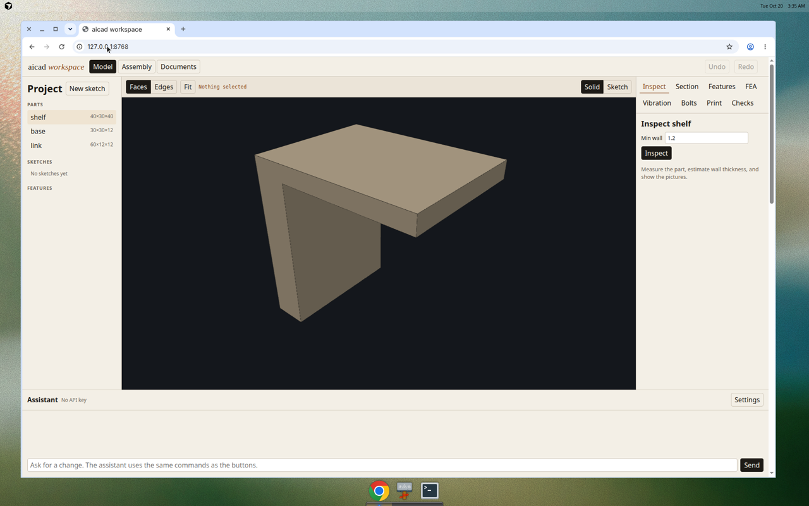

## Connect an assistant

Two ways. Either one edits the project you are looking at.

### Chat inside the app

Open the app, click **Settings** in the assistant panel, and paste an API key for OpenAI or Anthropic. The key is saved at `~/.config/aicad/settings.json` (on Windows that is `C:\Users\YourName\.config\aicad\settings.json`), mode private to your user. It is not written into the project folder. Then type in the box. The assistant uses the same commands as the buttons.

### An assistant outside the app (Cursor, Claude Desktop)

This is the MCP server. It speaks the same commands over a local pipe.

In Cursor, put this in `~/.cursor/mcp.json`. Use the full path to `aicad` inside the virtual environment, and the full path to the workspace folder.

Mac or Linux:

```json
{
  "mcpServers": {
    "aicad": {
      "command": "/full/path/to/ai-first-cad/.venv/bin/aicad",
      "args": ["serve", "--workspace", "/full/path/to/ai-first-cad/aicad_workspace"]
    }
  }
}
```

Windows:

```json
{
  "mcpServers": {
    "aicad": {
      "command": "C:\\full\\path\\to\\ai-first-cad\\.venv\\Scripts\\aicad.exe",
      "args": ["serve", "--workspace", "C:\\full\\path\\to\\ai-first-cad\\aicad_workspace"]
    }
  }
}
```

If the app is already running and you want the assistant to edit that same window, point the server at it:

```bash
aicad serve --connect http://127.0.0.1:8765
```

Use that command as the MCP command, with no `--workspace` argument. One process owns the files.

The same steps for Claude Desktop, Cursor, and any other MCP client that speaks stdio are in [docs/CONNECT.md](docs/CONNECT.md). That page also says how to allow a design script. One short session, a shelf that failed a wall check and was thickened, is in [docs/EXAMPLE_SESSION.md](docs/EXAMPLE_SESSION.md).

## A ten-minute tour

Stay in the project folder with the virtual environment activated.

**1. A bracket you can see.** The pictures are already in the repo. Open `examples/renders/motor_mount_contact.png`. It is a small plate with a boss, a bore, four motor screws, and three gussets. `examples/renders/motor_mount_section_y0.png` is a cut through the bore. `examples/renders/fea_gussets_stress_contact.png` is the same bracket under a motor load: the safety factor on that run was about 9, so the part is lightly loaded. To rebuild the pictures:

```bash
python examples/motor_mount.py
```

**2. Open the workspace on a small shelf and a two-link arm.**

```bash
python examples/print_and_robot.py
aicad app --workspace examples/print_workspace
```

Click **shelf** in the parts list. Orbit it. The shape is a wall with a plate sticking out.

**3. Print check.** Open the **Print** tab. Leave orientation on **best**, leave slice unchecked, and click **Analyze**. The suggested orientation is `y_up`: support area 0, height 30 mm, and every listed printer fits. The picture for the modeled orientation, with the plate's underside in red, is below. Red means the face leans more than 45° from vertical and is not the face sitting on the bed.


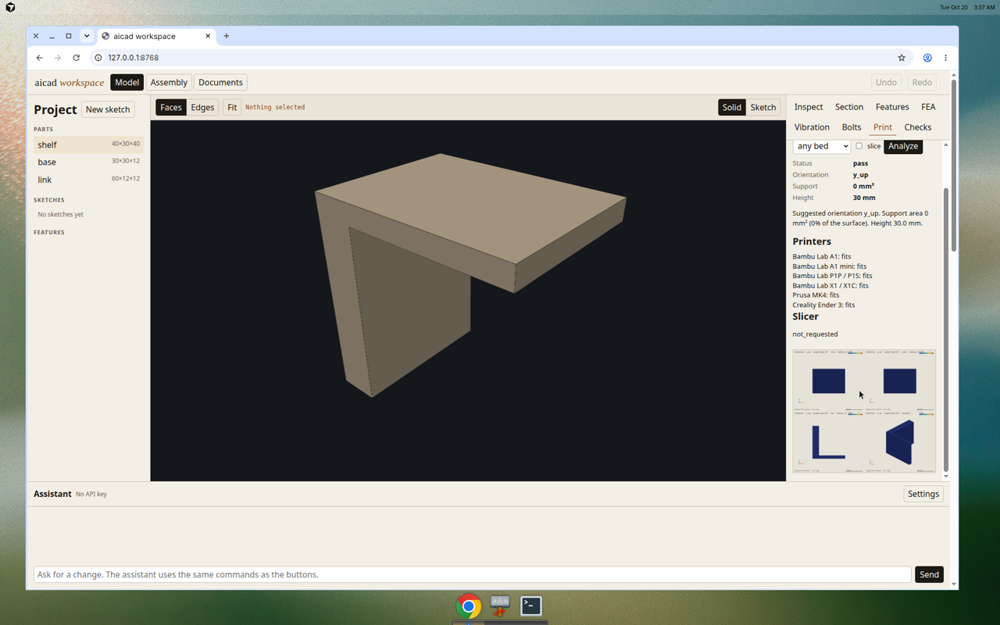

On a machine with PrusaSlicer, tick **slice** (or pass `"slice": true` from the assistant). For this shelf, at the slicer's default profile and a filament price of $20/kg, the modeled orientation was about **31 min 25 s**, **9.06 g**, **$0.18**. The suggested orientation was about **30 min 59 s** and **9.82 g**. Those numbers move if you change layer height or infill in the slicer. The density passed in is PLA at 1.24 g/cm³ so the gram line is not left at zero.

**4. Fits my printer.** Open **Documents**. Add a requirement: kind **fits my printer**, part `shelf`, limit `ender_3`, material `best`. Click **Check now**. It passes: the oriented shelf is 40 × 40 × 30 mm and an Ender 3 is 220 × 220 × 250 mm.

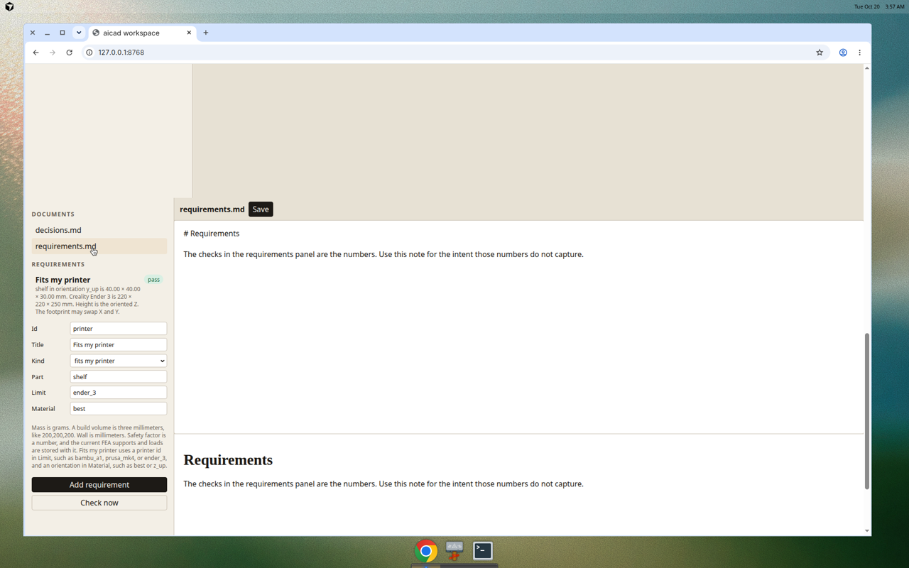

**5. Robot export.** Open **Assemblies**, click **arm**, click **Preview**, then **Export robot**. You get a URDF and a MuJoCo file under `examples/print_workspace/exports/robot/arm/`, with a shoulder hinge from −45° to 90°. If MuJoCo is installed, the line says the file was loaded and stepped.

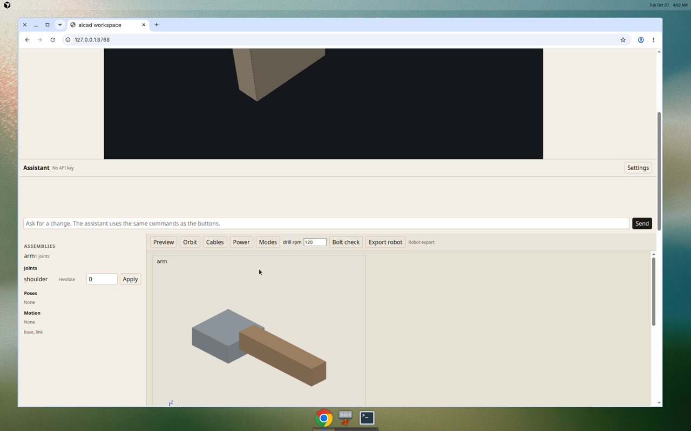

The same files, regenerated by the example script, live in `examples/robot_arm/` (`robot.urdf`, `robot.xml`, and `meshes/`).

**6. If you have another ten minutes.** `python examples/rod_arm.py` builds a two-joint arm with a hose, a cable, and a power estimate, and writes `examples/renders/rod_arm_strip.png`. `python examples/vibration_arm.py` needs CalculiX. It writes a magnified mode picture and a bolt check: the M8 joint slips under the sample shear while the bolt itself is still below yield.


**7. A drill-rod handler, checked and revised.** `python examples/rod_handler.py` builds one mechanism the way a handler on a diamond-core rig actually is: an eight-bolt slew base, plate links with lightening holes and gussets, pins, bushings, and a hydraulic cylinder on the shoulder, the elbow, and the jaw. The jaw seats NQ and HQ rod (about 70 to 89 mm). Open the workspace it writes (`examples/rod_handler_workspace`) and click **Assembly**, then **Orbit**. Each part has its own color, and the edges are drawn.

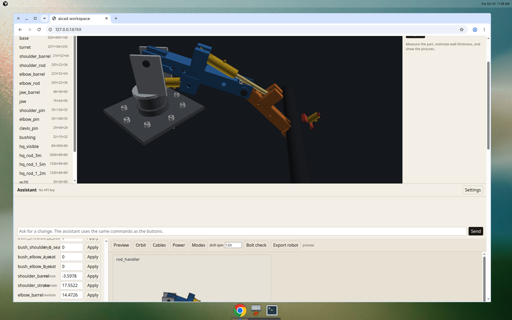

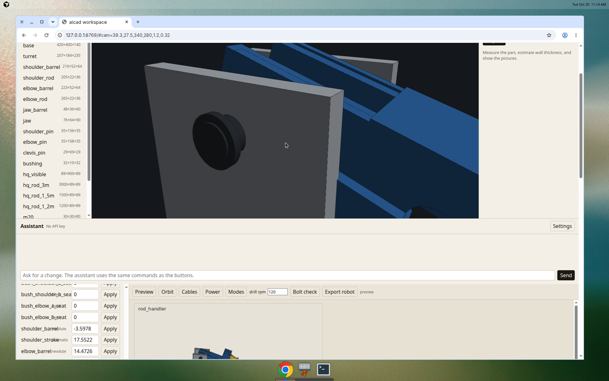

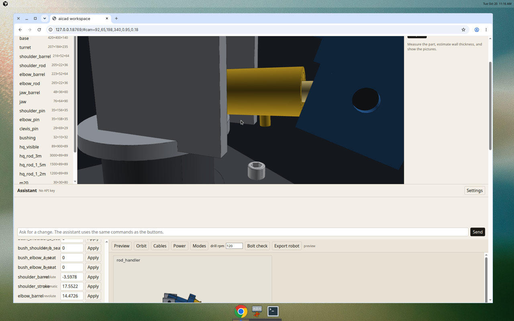

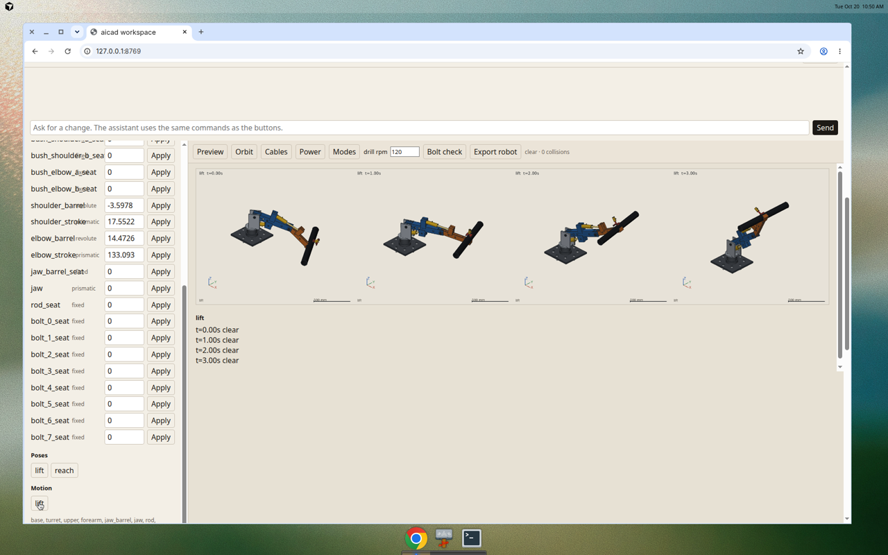

Closer renders of the same pose show the lightening holes, the bushings, and the clevis.

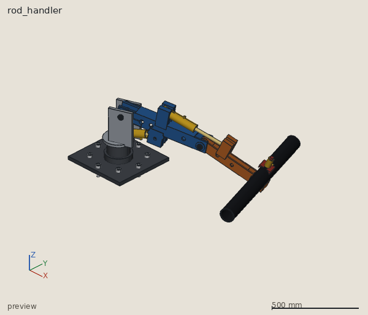

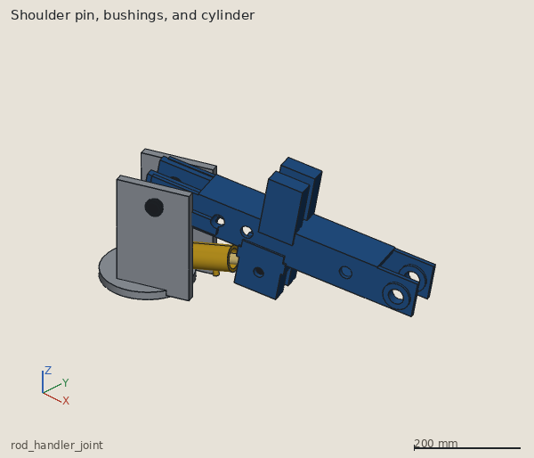

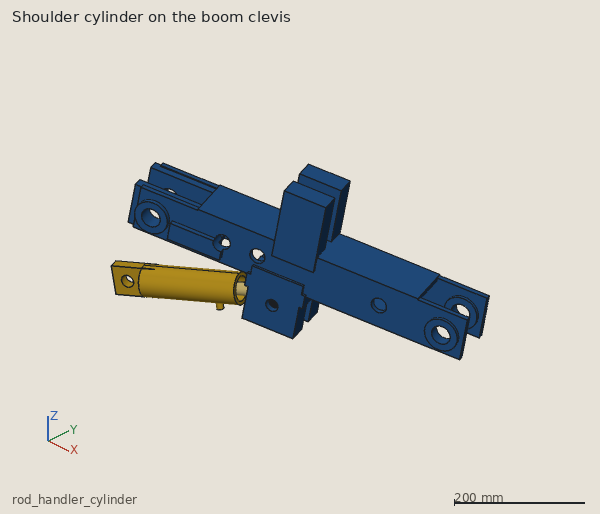

The lift carries the rod origin from −84 mm to 991 mm and does not collide. The strength picture below is the upper link after the clevis ears and the shoulder-eye doublers were added: peak 60 MPa, safety factor 4.16, under a 3 m HQ rod plus the cylinder forces that hold it.

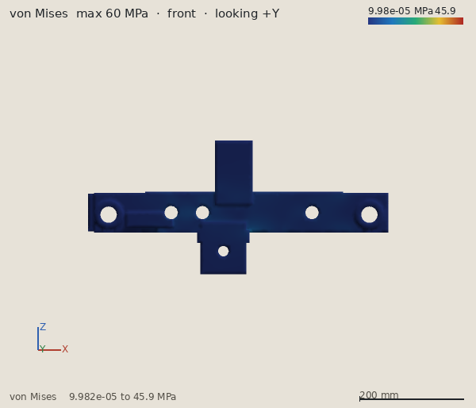

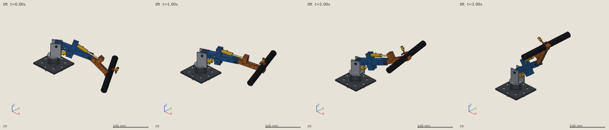

A 3 m HQ rod held only at one end rings at 9.5 Hz, which is a 570 rpm drill. With the chuck as the second support, a 1.2 m stick-up rings at 59 Hz and sits clear of 400 to 700 rpm. The iteration is written out in [examples/rod_handler_notes.md](examples/rod_handler_notes.md).

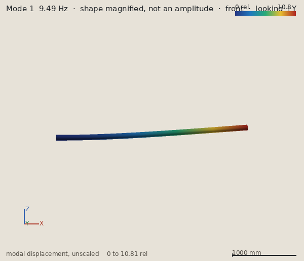

## Where the checks can mislead you

- Each result says whether it is a verified check of the CAD model or a rough estimate, and a simplified mesh is not allowed to look like a pass.
- The strength check is linear and elastic. It will not show a dent, a buckle, or two parts pressing on each other.
- Vibration pictures are exaggerated shapes so you can see the pattern. They are not how far the part moves at that speed. An assembly vibration check locks the hinges, so the frequencies come out higher than a real pin joint.
- The bolt number uses a handbook friction factor. It is not a measured torque test. A locking nut resists turning. It does not create clamping force.
- Print orientations are the six ways to point a modeled axis up. A diagonal pose is not tried. The slicer uses its default profile.
- The robot file does not enforce a gear, a linkage, or a cylinder relation. Those relations are written as comments. Effort and velocity on each joint are placeholders, not the power estimate.
- Scripts the assistant sends are real Python on your machine. Point the workspace at a folder you are willing to let it write.

The longer list is in the README under Limitations.
